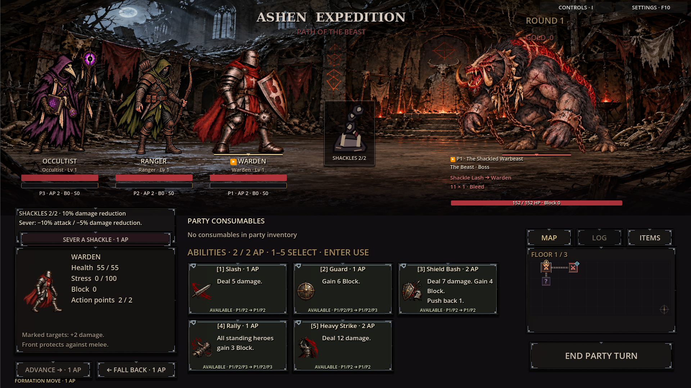
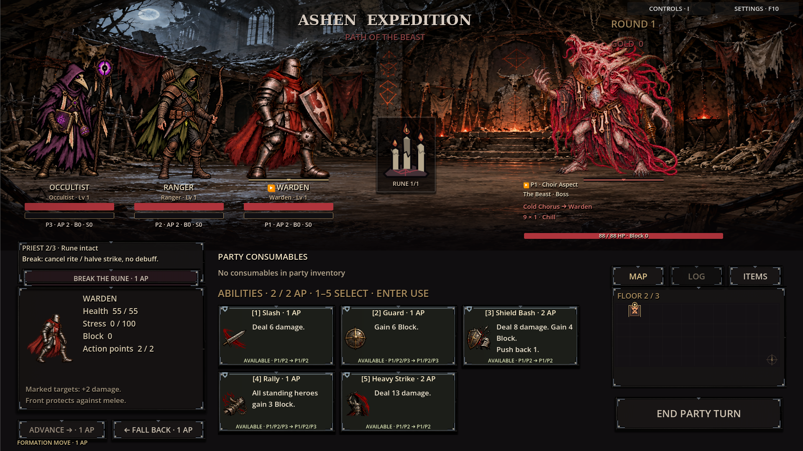
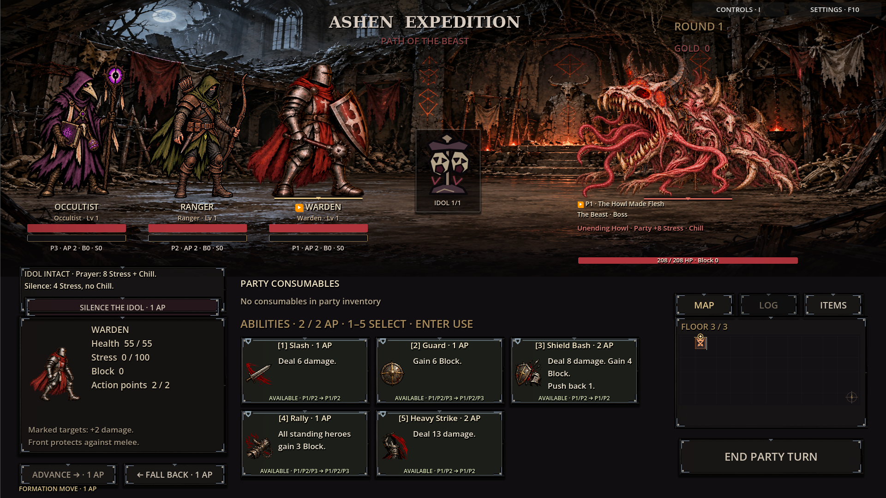
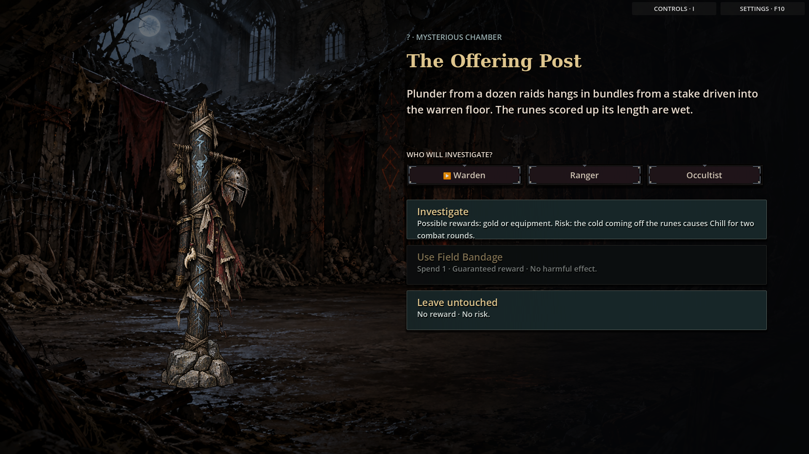
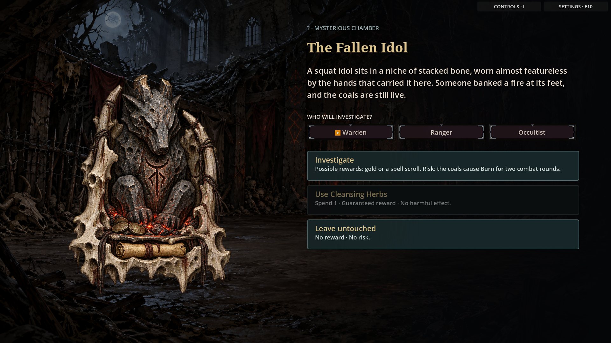

# Path of the Beast — implemented retheme

The approved beast-convert designs now replace the former Remade roster in combat.
The dungeon progresses through **Moonlit Warrens → Revel of Runes → Altar of the Beast**.
The Horned Priest changes from Wolf to Choir to Goat; the Choir replaces the proposed serpent.

| Creature | Attacks |
| --- | --- |
| Supplicant of the Path | Obsidian Offering · Rune Scour · Renounce Grief |
| Rune-Marked Half-Breed | Raking Claws · Bloodborne Venom · Grave-Cold Grasp |
| The Shackled Warbeast | Shackle Lash · Packbreaker · The Hunt Unbound |
| Horned Priest: Wolf Aspect | Throat-Taker · Twin-Fang Rush · Blood Rune Brand |
| Horned Priest: Choir Aspect | Cold Chorus · Hymn of Hollow Throats · Biting Choir |
| Horned Priest: Goat Aspect | Blighted Benediction · Blessing of the Pack · Horned Brand |
| The Howl Made Flesh | Unending Howl · Maw of the Beast · Lashing Tongues |

## In-game combat

## Full-screen discoveries

Combat atlas poses, room backgrounds, event props, objective labels and lore are updated.
This branch also includes the approved hero proportions: broader melee characters and slimmer ranged/caster builds.
Attack numbers, effects, encounter progression and rewards retain their existing balance.
Stable creature IDs, legacy Remade taxonomy aliases and equipment-stat keys preserve save compatibility.

Validation: 92 Godot smoke checks, including Priest phase transitions, legacy taxonomy,
unchanged base health, sprite loading, boss objectives, equipment and expedition flow.
Screenshots are captured from the running game.
