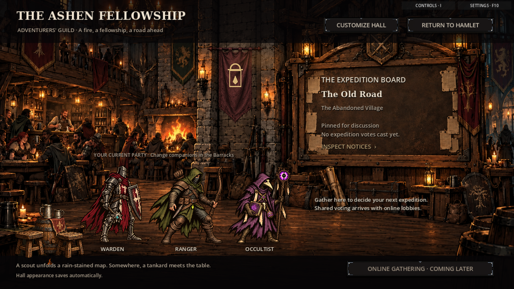
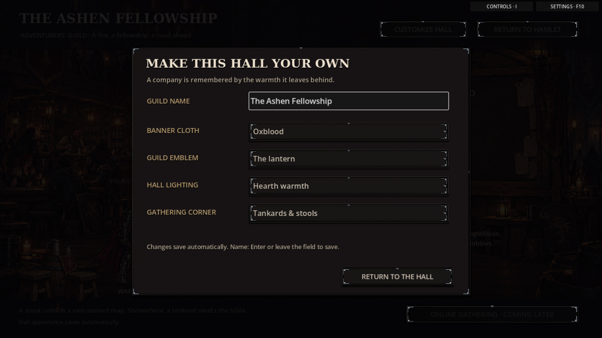
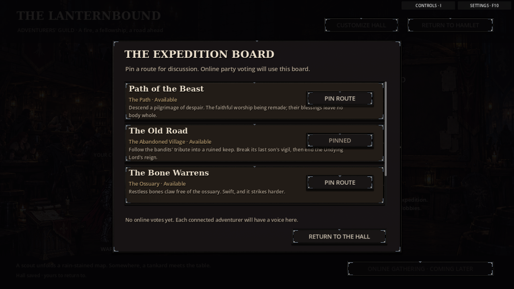

# The adventurers' guild: first playable hall

Enter the Hamlet and choose **THE ADVENTURERS' GUILD** at the upper left. The hall is a local social-hub foundation, with a busy painted tavern, warm hearth, current-party gathering positions, and a notice board embedded in the room.



## Customize your company

**Customize Hall** offers a guild name, four banner colors, three emblems, three lighting presets, and three gathering-corner arrangements: tankards/stools, weapons/shields, or books/maps. The banner uses textured cloth; the room, foreground furnishing, and heroes share the selected lighting. The existing party supplies the gathering heroes; visit the Barracks to change them.

Changes save automatically in **`user://guild_hall.cfg`**, separately from expedition saves and progression. Names save on Enter or leaving the field, are limited to 32 characters, and display with truncation when needed. Missing or malformed cosmetic values fall back to defaults. Unsupported-version and unreadable profiles are preserved; failed writes display an explicit message. Successful writes stage a replacement file before renaming it into place.



[View the moonlit/archive variation](guild_hall/moonlit.png) · [Settlement entrance](guild_hall/settlement.png)

## The expedition-voting space

The physical **Expedition Board** is the reserved party decision point. Click it to inspect released public expedition notices and pin an unlocked route for discussion. Locked notices cannot be pinned; unreleased and internal settlement-reclamation missions are not shown on this public board. A pin persists with the hall, but does not select/start a campaign, consume resources, advance gameplay RNG, or count as a multiplayer vote.



Steam invites, connected player seats, ready checks, and shared expedition votes are not implemented yet. The online-gathering control is disabled and identifies that limitation. The next session milestone will replace local route pins with host-approved ballots from real participants; the visual board and its scene entry are already in place.

## Atmosphere and scope

Background patrons, maps, tankards, and a hearth give the room its anime-adventurers'-guild social atmosphere while retaining the game's grimdark illustration style. Party heroes breathe gently, firelight/dust provide restrained motion, and short ambient descriptions rotate without consuming gameplay randomness. The existing scene-animation setting disables decorative motion; hall modals pause the hall's dust/firelight clock.

Original walking remains the game default. Its **Experimental walking** choice is unchanged. No network transport, new campaign economy, or progression rewards are introduced in this hall pass.

Artwork lives in [the editable guild-hall library](../assets/art_library/presentation/guild_hall/README.md). Replace the original PNGs there to port hand-drawn revisions. The full [co-op plan](guild_hall_coop_plan.md) describes the standalone/Steam session work that follows.

## Verification

Verified on Godot 4.6.3 with native 1280 × 720 screenshots of the settlement entry, room, appearance controls, and notices. Behavioral coverage checks cosmetic roundtrips, input sanitization, failed/future/corrupt-file preservation, live art layers, five hero silhouettes, matching lighting, route eligibility, disabled online controls, reduced motion, unchanged campaign state/RNG, and navigation back to the settlement. The malformed-file fixture intentionally produces two ConfigFile parse errors before proving the file is preserved.

```sh
godot --headless --path . --script res://tests/guild_hall_smoke.gd
godot --headless --path . --script res://tests/settings_saves_smoke.gd
godot --headless --path . --script res://tests/quiet_hallway_motion_smoke.gd
godot --path . --audio-driver Dummy --script res://tests/guild_hall_preview.gd -- /absolute/preview/directory
```
