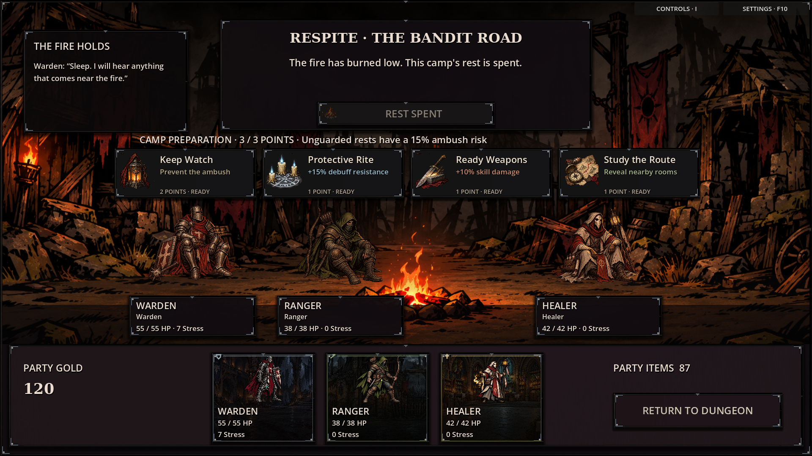
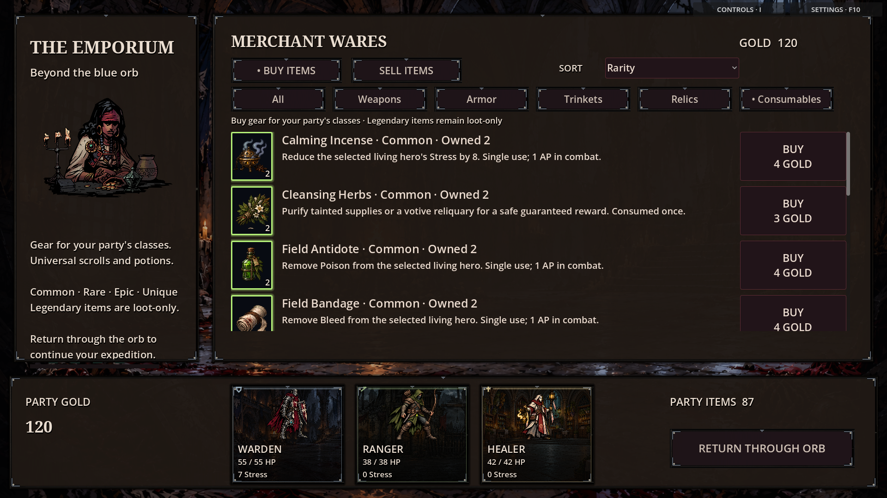
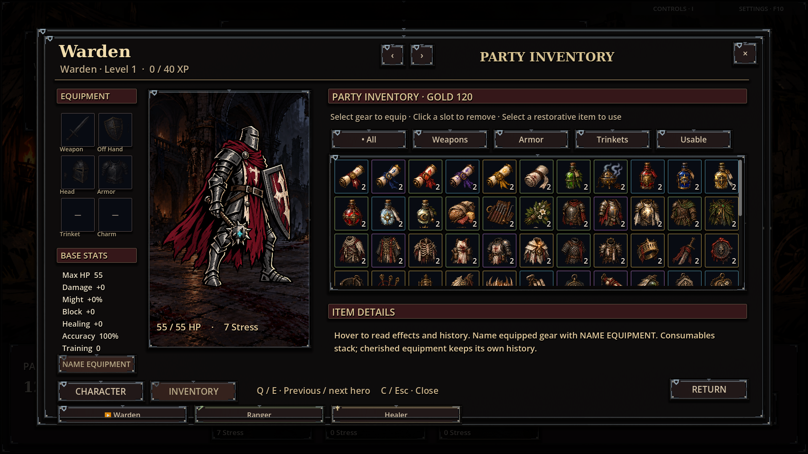

# Painted items, camp actions and a live artwork library

All **87 current items** now have separate grimdark illustrations: medicines,
scrolls, supplies, weapons, armour, trinkets and boss trophies. Thick ink contours,
weathered materials, restrained magical light and varied silhouettes replace the
flat SVG symbols. Four transparent 1536×1024 source sheets supply 24 tiles each;
the source pixels remain unchanged and individual atlas definitions select the
256×256 sprites. The remaining tiles supply five camp illustrations and four
dim empty-equipment-slot symbols.

Camp preparation uses illustrated cards for Keep Watch, Protective Rite, Ready
Weapons and Study the Route. Each shows its effect, point cost and state: rest
first, ready, prepared or insufficient points. The character record uses a compact
two-column version with the same artwork and tooltips. Rest has its own fire icon.
Campers retain their ground line and firelight, with their size adjusted to leave
space beneath the larger action cards.

## Preview







## Hand-drawn replacement workflow

The canonical folder is **[`assets/art_library`](../assets/art_library/README.md)**.
Existing artwork banks moved there together with their atlases, imports, region
definitions and credits; the game loads those files directly. It includes generated
art currently used by the game and retained variants/fallbacks.

Open `assets/art_library/catalog.html` locally to search filenames and view atlas
tiles. `manifest.json` indexes **557 image/resource entries**, including dimensions,
atlas coordinates, known literal references and individual override names.

For example, export your drawing to:

```text
assets/art_library/items/healing_potion.png
assets/art_library/items/warden_sword.png
assets/art_library/camp/watch.png
assets/art_library/camp/ward.png
```

A same-name PNG automatically overrides its generated atlas resource. Reimport in
Godot and reopen the affected UI or restart the game. Item IDs, cherished item
histories, quantity badges, rarity borders and gameplay effects stay intact.
Transparent 256×256 or 512×512 canvases are recommended for these icons. The library
guide explains how to replace backgrounds and animation sheets while preserving
their dimensions, ground lines and frame regions.

## Verification

Checked camp pre-rest, ready, watch-posted and exhausted-point states, character
camp skills, inventory and merchant consumable/weapon/armour views at both 720p
and 1080p. The broader 34-state visual audit was repeated at both resolutions to
check the artwork migration across scene families. These are controlled UI fixtures,
not new balance playtests.

Passed **18 relevant checks**:

- Library resource loading; all 557 entries resolve, with matching PNG dimensions
  and valid atlas references.
- Item/camp art: 87 distinct item regions, PNG priority, base IDs for cherished
  items, camp icons and actual rest/preparation button actions.
- Existing project-art, static-screen, class-UI and visual-overlay checks.
- Camp/merchant generation across 200 seeds, unique-item effects and depth/journey
  boons, scouting, ambushes and save continuity.
- Hero appearances, equipment costumes and creature atlas/pose routing.
- Combat presentation, room presentation and settlement/UI foundation.
- Controls guide, settings/saves and save validation.

Native captures completed without script or shader errors. The virtual display
reports its usual unsupported V-sync/monitor warning; some harnesses retain the
existing shutdown resource warning. Validation used Godot 4.6.3.

The depth/journey test's manually constructed camp rooms were updated to include
`seen: true`, which the existing save validator requires. Production journey and
save rules were not changed.

## Reproduce

```sh
python3 tools/index_art_library.py
godot --headless --path . --script res://tests/art_library_resources_smoke.gd
godot --headless --path . --script res://tests/item_camp_art_smoke.gd
godot --path . --audio-driver Dummy --script res://tests/item_camp_art_preview.gd -- /absolute/preview/directory 1920 1080
```

Use isolated user data (`XDG_DATA_HOME` on Linux) for the capture fixture. It creates
sample inventory/progression and audit saves. Substitute `1280 720` for the smaller
resolution.
