# Ranger, Occultist and Healer equipped combat weapons

Equipping a weapon changes the held weapon in combat, including attack/cast poses.
Original, alternate and relic armour remain independent. The Ranger stays smaller;
the Occultist and Healer retain slim builds. The Crusader keeps his current design.

## All twelve weapons

[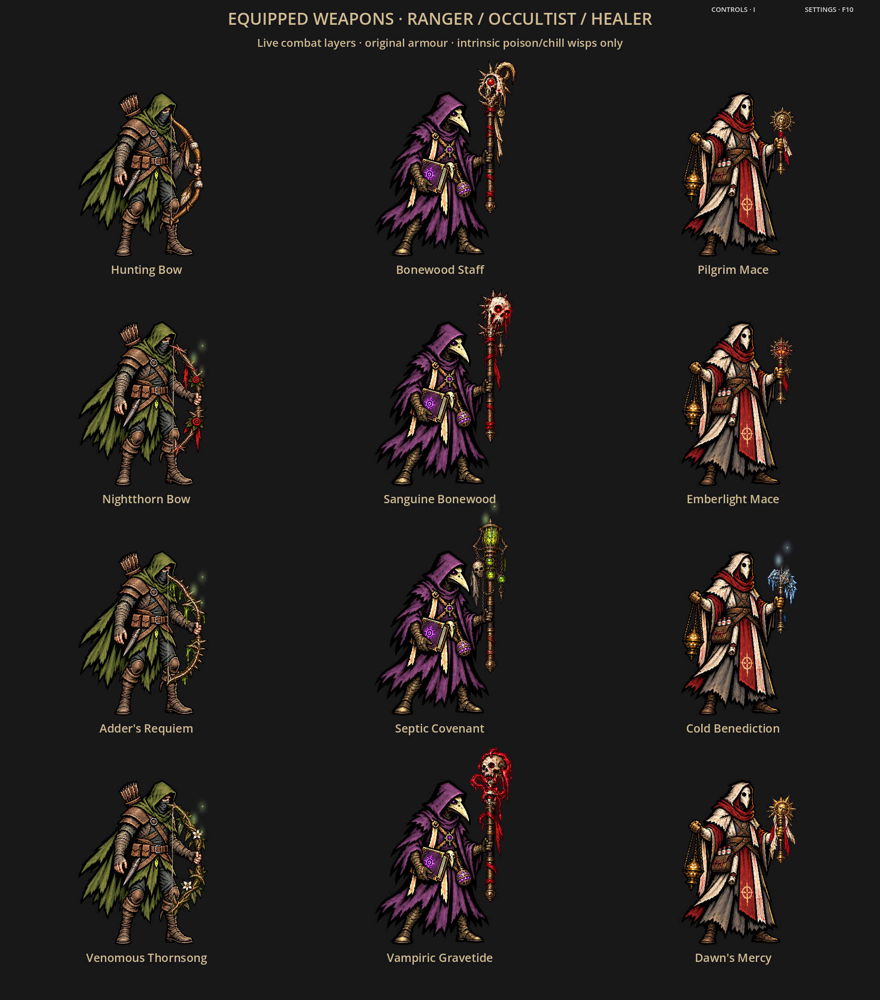](weapon-gallery.png)
[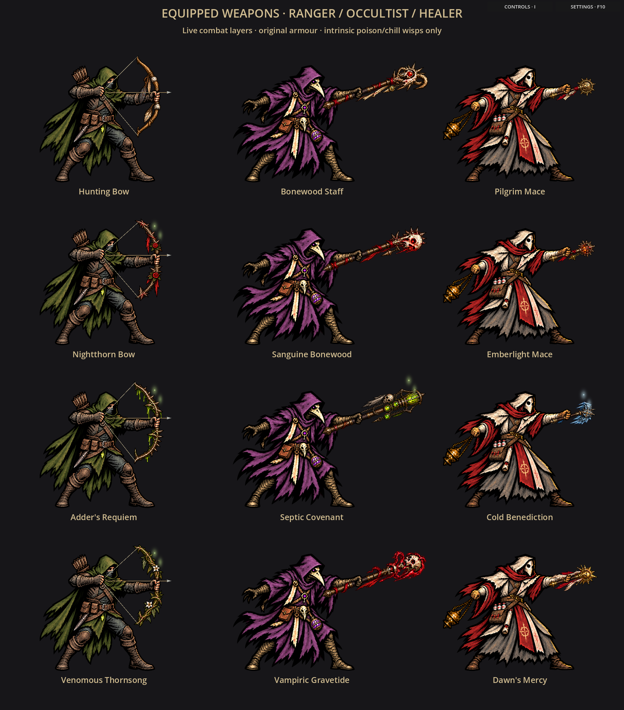](attack-gallery.png)

These galleries arrange the live combat layers for inspection.

## Grip and shaft corrections

The weapon atlases were revised after close-up review exposed misplaced bow
pivots and crooked staff shafts. Every staff/mace now has a continuous straight
shaft and a clear wrapped grip. Bow limbs retain their natural curve, with a
straight central gripping section. Pivots are measured on opaque handle pixels.
Arrows run level above the holding fingers; drawing fingertips overlay the nock
and string. The unchanged body art and selected armour remain in use.

[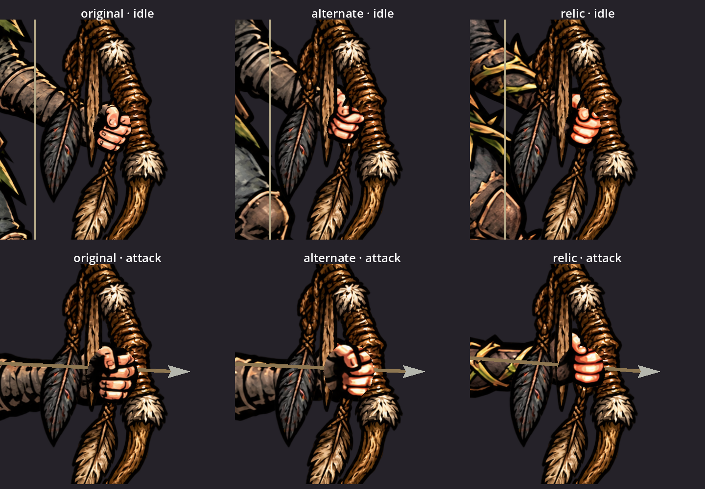](grips-before.png)
[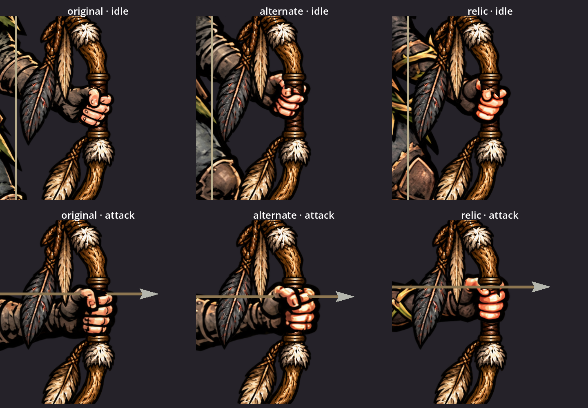](grips-after.png)

These enlarged crops are rendered from the actual model, including all three
Ranger outfits in idle and attack poses.

| Hero | Weapon | Intrinsic smoke and pixel sparkles |
| --- | --- | --- |
| Ranger | Hunting Bow | None |
| Ranger | Nightthorn Bow | Poison green; existing 15% chance |
| Ranger | Adder's Requiem | Poison green; existing 30% unique chance |
| Ranger | Venomous Thornsong | Poison green; existing 25% chance |
| Occultist | Bonewood Staff | None |
| Occultist | Sanguine Bonewood | None; life drain retains its combat effects |
| Occultist | Septic Covenant | Poison green; existing 30% unique chance |
| Occultist | Vampiric Gravetide | None; life drain retains its combat effects |
| Healer | Pilgrim Mace | None |
| Healer | Emberlight Mace | None; regeneration does not add Burn |
| Healer | Cold Benediction | Chill blue; existing 30% unique chance |
| Healer | Dawn's Mercy | None; regeneration retains its combat effects |

The approved Warden shader adds soft wisps and tiny blinking neon pixels to the
weapon head and respects ambient-motion settings. Only actual offensive weapon
properties activate it. Names, resistances, offhands and temporary statuses do not.
These visuals do not guarantee status procs or change gameplay.

## Actual combat

[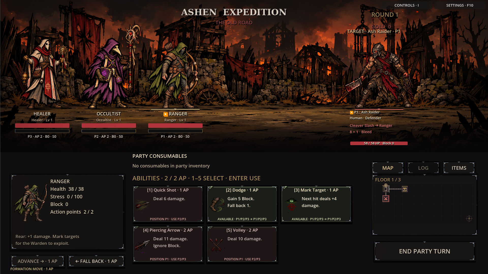](common-weapons.png)

[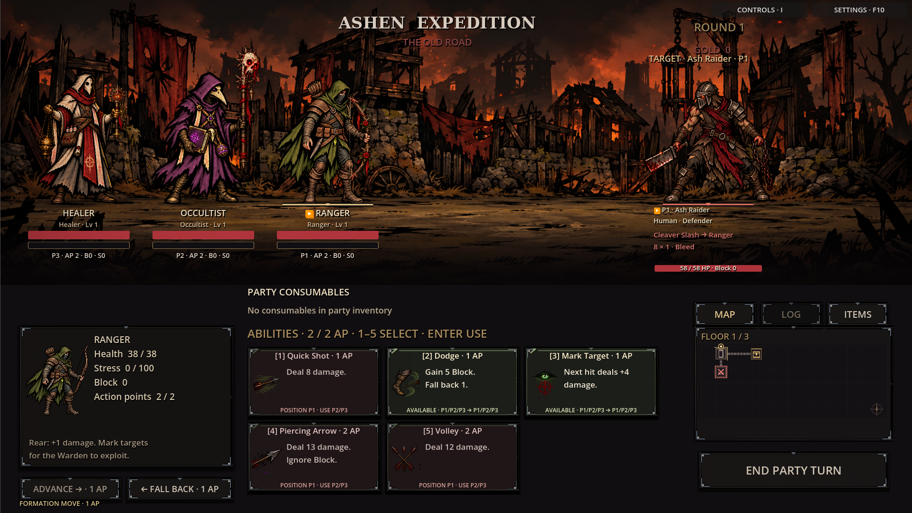](epic-weapons.png)

[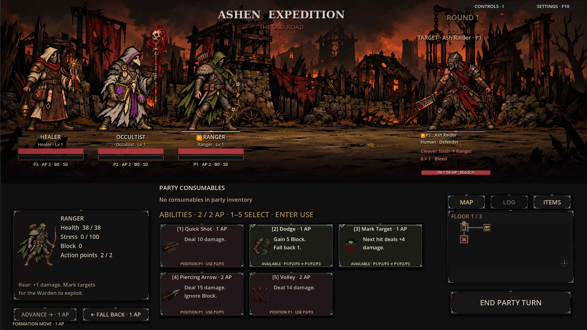](alternate-armour.png)
[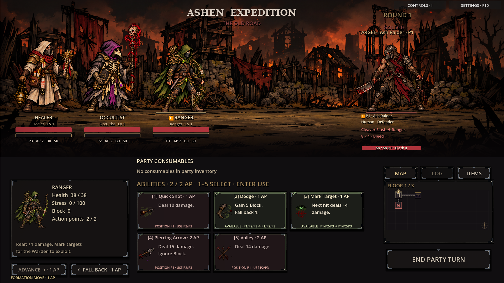](relic-armour.png)
[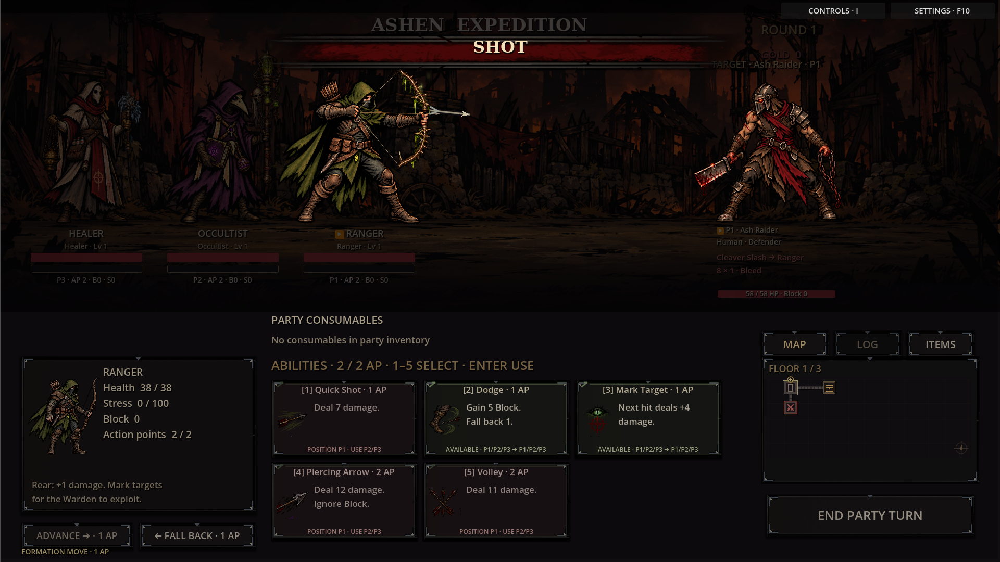](ranger-attack.png)
[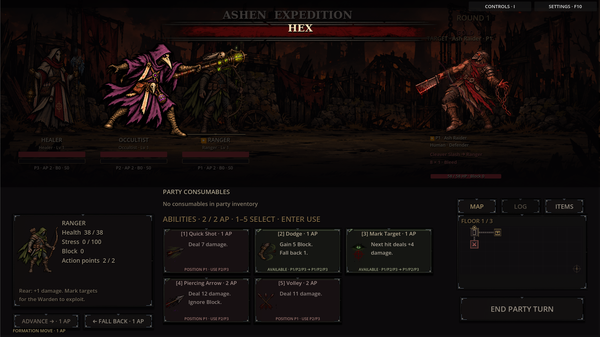](occultist-attack.png)
[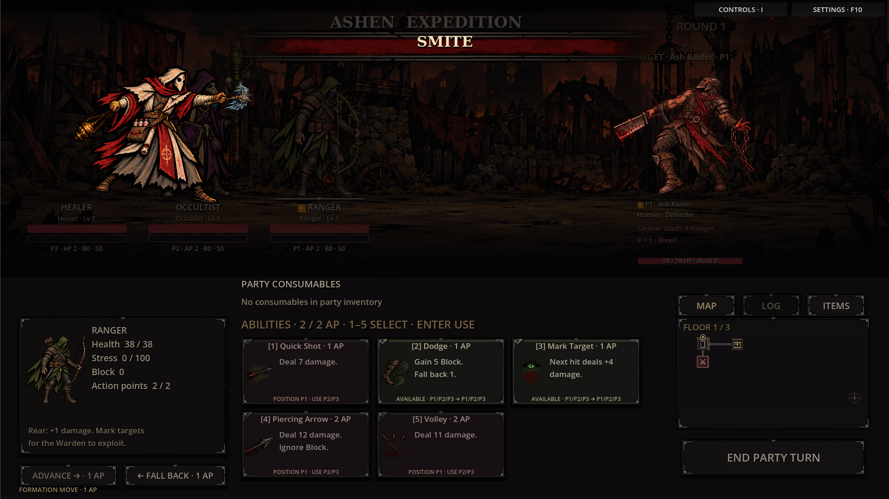](healer-attack.png)

The Ranger's attack draws the string to his rear hand and adds a nocked arrow.
Forward hands overlay weapons using matching source-pixel texture UVs. Measured
profiles keep grips attached and soles grounded. Wider composites accommodate
extended staves. Cinematic sizing and stage bounds account for transparent space
without shrinking the painted hero or unnecessarily pushing him out of his lane.

## Compatibility and scope

Named/heirloom items resolve through their existing base IDs and retain actual
properties. Unequipping leaves an empty hand. Queued attacks retain captured gear.
Death frames suppress weapon wisps and keep the existing death/status presentation.
Idle/hurt/guard use the ready pose; attack/cast/windup use the action pose.

Equipped armour, manual outfits and Equipment Costumes settings remain supported.
These classes keep selected armour even with a legendary weapon and no armour
item, matching the Warden. Existing saves need no migration. Travel, inspection
portraits and the Crusader retain their existing artwork. No new items, abilities,
unlock rules or balance changes are introduced.

## Artwork and validation

Eighteen reference-based body edits and three weapon atlases live in
`assets/art_library/party_weapons/`. Imagegen PNGs are copied unchanged. The Ranger
atlas received an additional edit removing static strings, now drawn by the game.
Full prompts/references: [generation-prompts.json](generation-prompts.json).
Source hashes: [art-provenance.json](art-provenance.json).
`profiles.json` records regions and attachment points without modifying PNGs.

Validation: 95 headless smoke checks and native `attack_profiles_smoke.gd`.
Additionally, native `party_weapon_art_visual.gd` checks all 72 combinations
(three classes × three outfits × four weapons × two poses) for complete silhouettes,
headroom, grounding and attached grips. The integration test covers named gear,
armour selection, effects, unequip, queued snapshots and consistent attack size.
`party_weapon_grips_smoke.gd` verifies opaque grips, continuous shaft axes and
level nocked arrows above the holding fingers. Source revisions and original
generations are both recorded in the prompt provenance.
