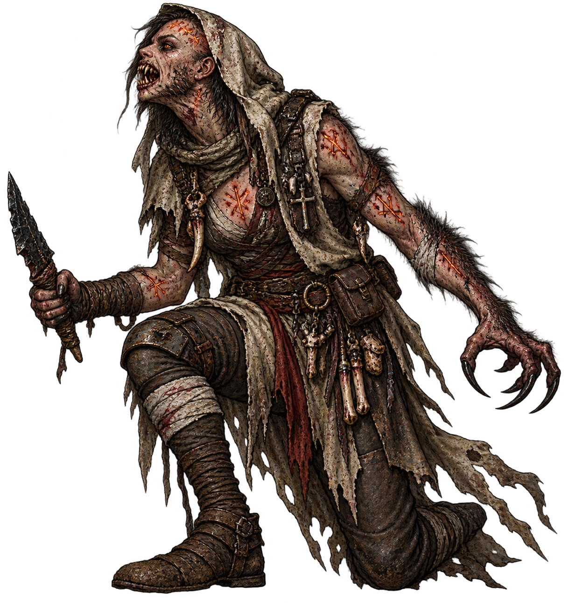
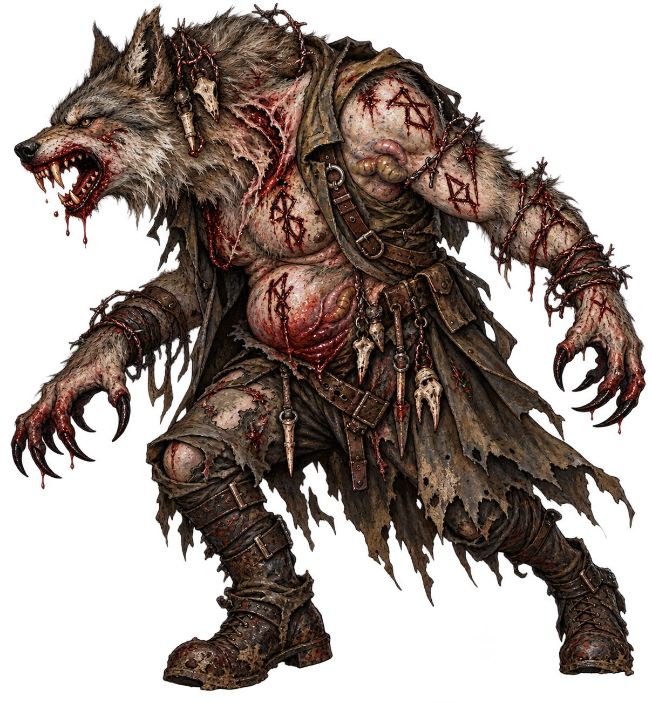
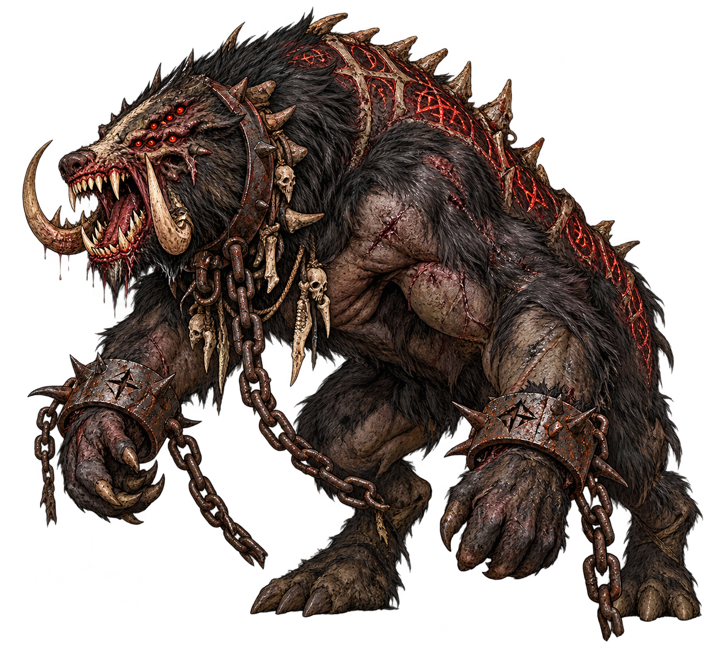
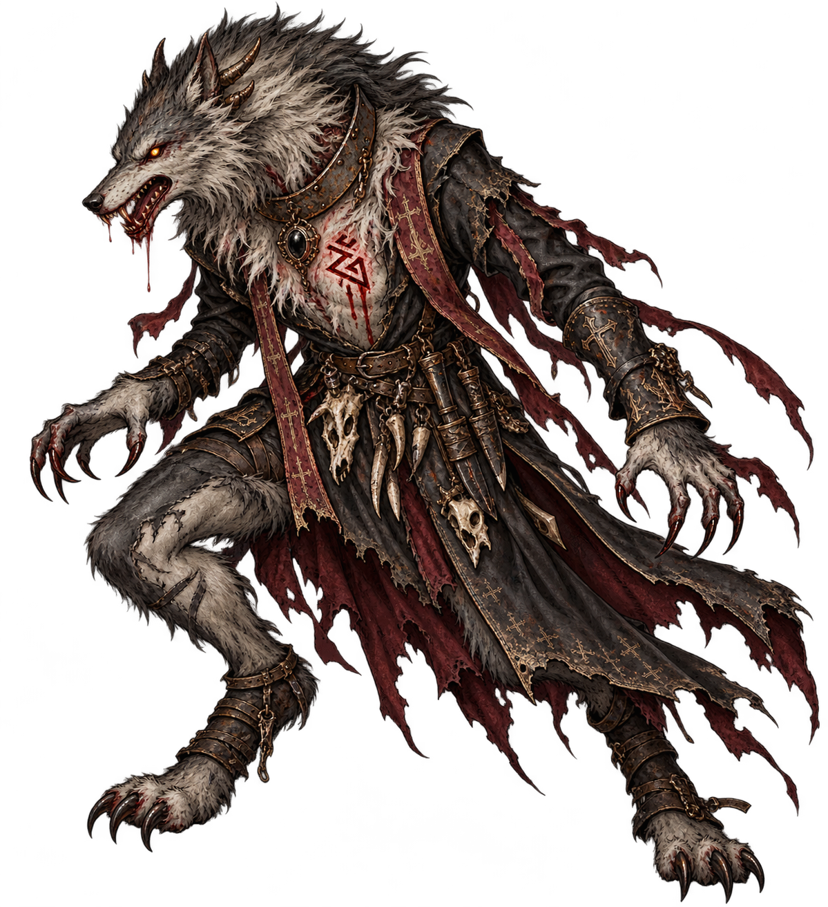
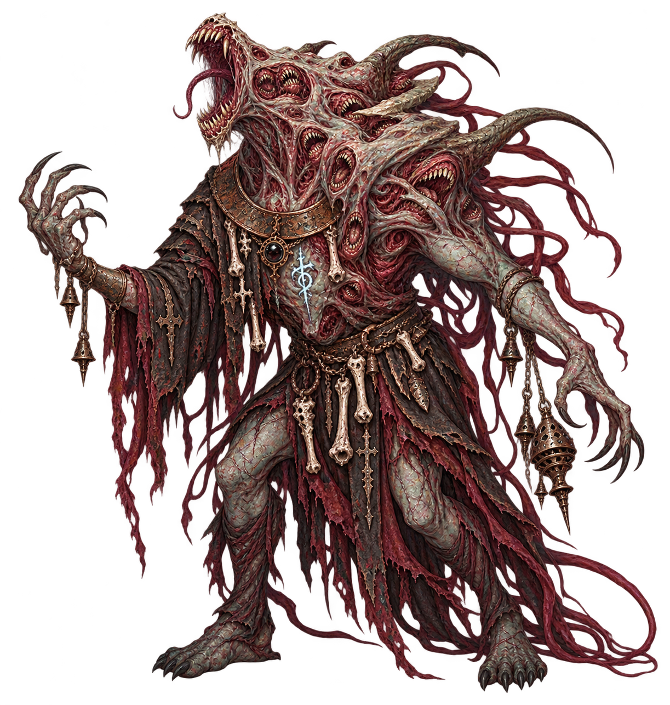
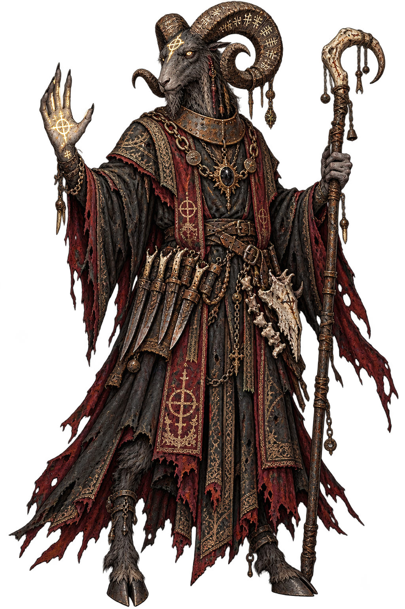
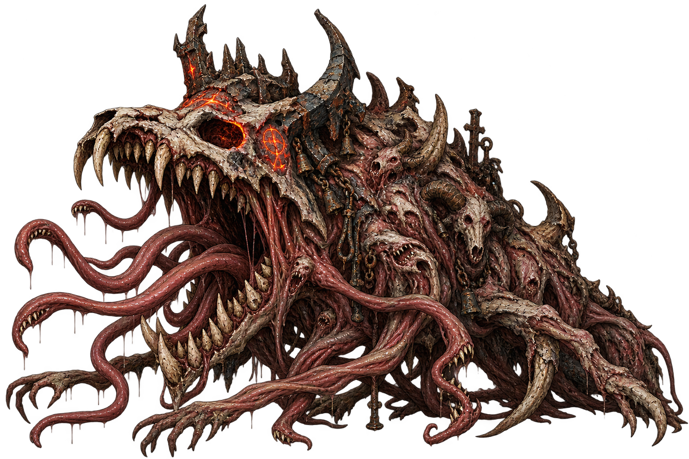
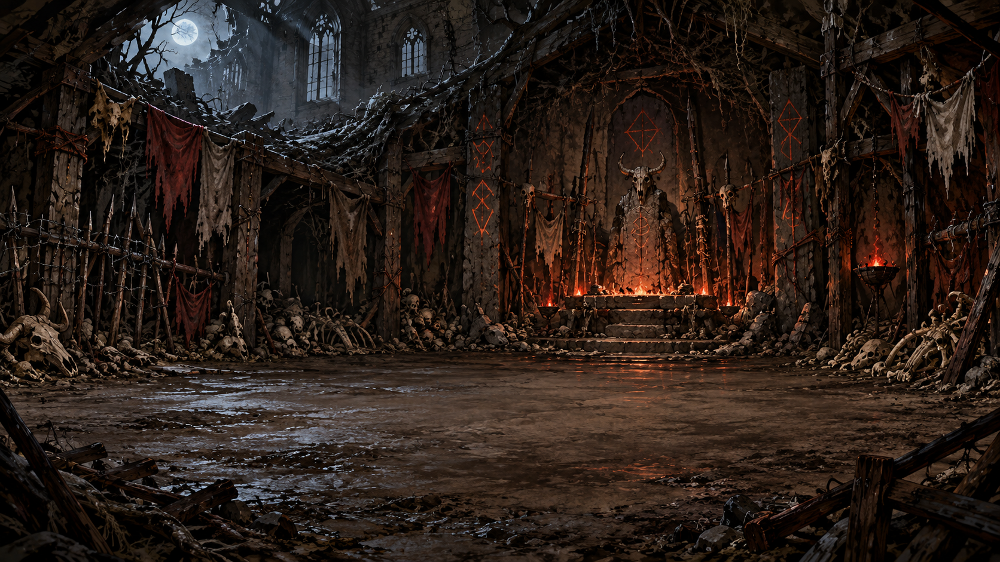
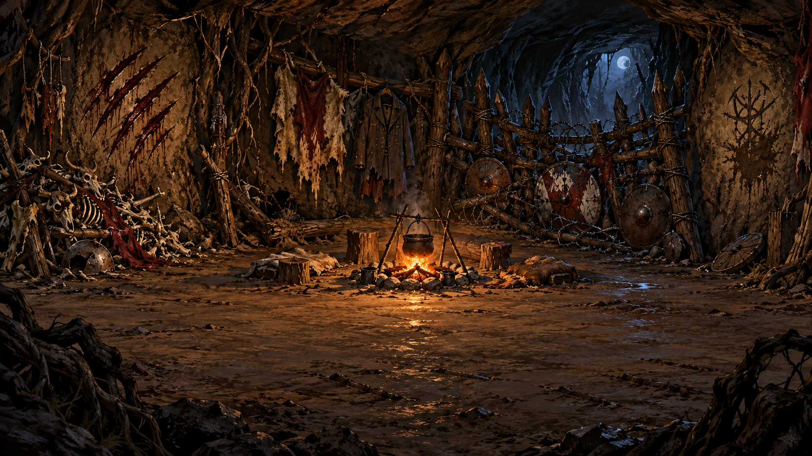

# Path of the Beast — reimagining concepts

Approved concepts generated from the supplied retheme diff. These designs now
replace the live Beast roster, combat atlases, environments and event props.
See the [implemented encounters](../beast_retheme/README.md) for in-game screenshots.

## Image gallery

Click an image to view the full-size concept.

| Supplicant | Half-Breed | Shackled Warbeast |
| --- | --- | --- |
|  |  |  |

| Priest: Wolf | Priest: Choir | Priest: Goat |
| --- | --- | --- |
|  |  |  |

### The Howl Made Flesh

### Moonlit warren

### Barricaded camp

## Enemy designs

- [Supplicant of the Path](anguish_penitent.png): a recent voluntary convert, caught between grief and the first hunt.
- [Rune-Marked Half-Breed](anguish_vessel.png): a wolf-headed soldier stalled between human and beast.
- [Shackled Warbeast](harrowed_giant.png): the first guardian, a huge chained boar/bear-like pack killer.
- [Horned Priest — Wolf Aspect](coterie_seamkeeper.png): lean, fast and predatory.
- [Horned Priest — Choir Aspect](coterie_cantor.png): a distorted humanoid chorus of clustered jaws, pale flesh and trailing sinews.
- [Horned Priest — Goat Aspect](coterie_matron.png): the composed, ancient pack leader revealed last.
- [The Howl Made Flesh](howling_head.png): a meteoric wolf idol becoming the primordial hunger it represents.

## Environments

- [Moonlit warren](beast_sanctuary.png): clawed earth, ruined chapel masonry, runes, bone and a low altar.
- [Barricaded camp](beast_camp.png): a vulnerable refuge held against the hunting pack.

The overall progression is **Moonlit Warrens → Revel of Runes → Altar of the Beast**.
The second form was revised from Serpent to Choir Aspect using the supplied
mouth-cluster and flesh-idol references. The original supplied diff remains
recorded in source-prompts.json; the [current revision prompt](revised-prompts.json) is recorded separately.

The three Priest forms share ecclesiastical clothing, iron and bone motifs so
they read as one shapeshifter rather than three unrelated bosses.

## Review of the supplied patch

The direction replaces the surgical-cult theme with willing beast converts,
war relics, rune worship and a calculating pack leader. This gives the enemy
roster a readable escalation from human remnants to primordial predator.
Existing creature IDs, the `remade` faction identifier and item-stat keys are
retained, which helps preserve current equipment and saved-data compatibility.

Integration is complete: combat frames and atlas anchors have been measured,
active room layers and event props replaced, prompt paths corrected, and legacy
Remade tags covered by regression checks. Source prompt wording is recorded in
[source-prompts.json](source-prompts.json); the Choir revision is recorded in
[revised-prompts.json](revised-prompts.json).
