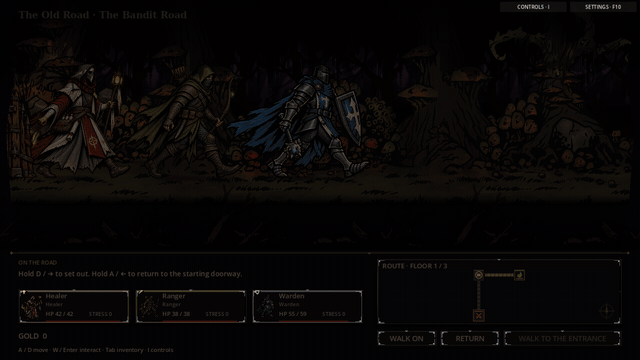
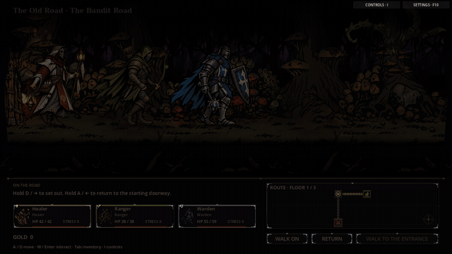

> Optional Manual walking only. The default dungeon uses [instant room selection](room_travel/README.md).

# Quiet hallway motion

The previous walk loop switched between four separately illustrated poses. Their
cape shapes, weapon positions and measured widths differed substantially, so cycling
them made the party visibly pop between silhouettes. Pausing held a walk frame;
arrival switched to another portrait and could produce another abrupt change.

The original four-frame walking loop is the default. With **Experimental walking**
enabled in settings, hallway actors keep a consistent, planted-foot stance through travel, pauses
and arrival. A small opt-in shader deformation supplies breathing, gentle upper-body
sway and distance-linked weight shifts. Starts and stops ease over roughly a third
of a second. Each class has its own amplitude/phase profile. Boots and contact
shadows remain on the floor; actor rectangles, travel speed and collision/input
areas stay stable.

Equipment highlights use the same deformation and follow the portrait's flip when
retracing a passage. Palette colors and original, alternate and relic costumes remain
supported. Missing walk atlases use the grounded standing portrait. Existing source
images and all four legacy walk frames remain in the live art library.

## Before / after

The same 13-second controlled sequence runs idle → walk → pause → retrace → walk
→ arrive. Both versions use the same scene, route, inventory and input schedule.
GIFs are compact 640×360 / 6 fps previews of the native capture; use the video for
a clearer view of the small movements.

| Before | After |
| --- | --- |
|  |  |

[Watch/download the 1280×720 animation preview](quiet_hallway_motion/after.mp4)

## Controls and scope

**F10 → Experimental walking** opts into this subtle presentation and persists the
choice; it starts disabled, including for existing settings files. Disabling it restores
the original frame cadence and standing portrait on arrival. The separate
**Animate scenes & hero movement** option controls breathing and scene effects;
disabling that removes portrait deformation while retaining navigation and footsteps. Settings,
inventory and other modal panels freeze actor motion. A manually paused party still
breathes when motion is enabled, without advancing the route or playing footsteps.

This is a native Godot procedural presentation pass using the current illustrations.
It does not require a Spine runtime or Leonardo account. It provides the restrained
glide and breathing requested here; independently rigged limbs and cloth would be
a separate Spine/mesh animation pass.

## Implementation and tuning

- `scenes/expedition/hallway_travel.gd` selects the quiet stance and advances separate
  presentation clocks. Gameplay continues to commit only when a passage is entered.
- `scripts/hallway_actor_motion.gd` owns per-class profiles and per-actor shader
  parameters, preserving the palette material and synchronizing equipment layers.
- `assets/shaders/actor_motion.gdshaderinc` defines the shared foot-anchored
  deformation. Existing combat/portrait/camp materials leave it disabled by default.
- `scripts/equipment_accents.gd` keeps overlay orientation matched to the parent.

At the 280-pixel logical actor height, motion remains around one pixel at the upper
body and fades to zero at the feet. Breathing has a roughly four-second cycle; gait
weight shifts follow distance rather than consuming gameplay randomness. The
exponential start/stop blend is independent of frame rate.

## Verification

Passed ten relevant checks: `quiet_hallway_motion_smoke`, `dynamic_hallway_smoke`,
`hallway_navigation_smoke`, `exploration_polish_smoke`, `hero_appearance_smoke`,
`equipment_costumes_smoke`, `equipment_feedback_smoke`, `room_presentation_smoke`,
`controls_guide_smoke` and `presentation_smoke`.

Coverage includes all five classes and three costume families, stable textures and
grounding, idle breathing, eased starts/stops, reduced-motion/modal behavior,
gear synchronization, backtracking, missing-atlas fallback, 20 themed arrivals,
explicit destination activation and unchanged health, inventory, rooms, gold and RNG.

Native OpenGL before/after captures completed with no script or shader errors.
The exploration test emits the same headless font diagnostics as its unchanged
baseline, while its assertions pass; the native preview renders its headings normally.
Validation used Godot 4.6.3 in the execution environment. Virtual-display monitor/
V-sync notices remain environment diagnostics.

```sh
godot --headless --path . --script res://tests/quiet_hallway_motion_smoke.gd
godot --path . --audio-driver Dummy --script res://tests/quiet_hallway_preview.gd -- /absolute/frame/directory
```

The preview records 156 native 1280×720 PNG frames at a simulated 12 fps. Use
isolated user data for that fixture. The shipped game renders motion continuously
at its normal frame rate; the capture rate is only for the review clip.
