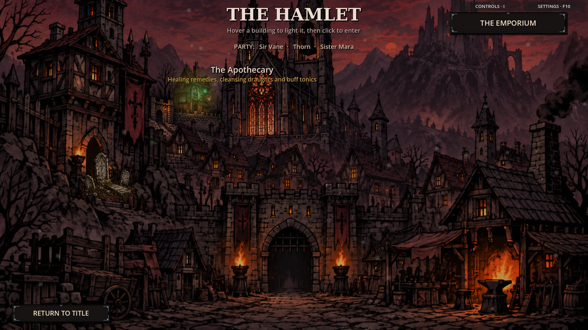
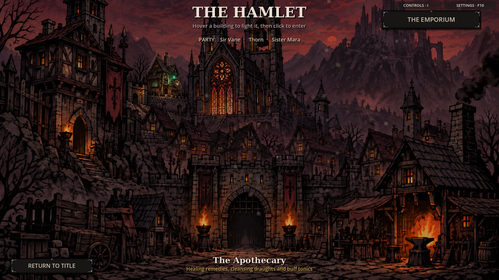
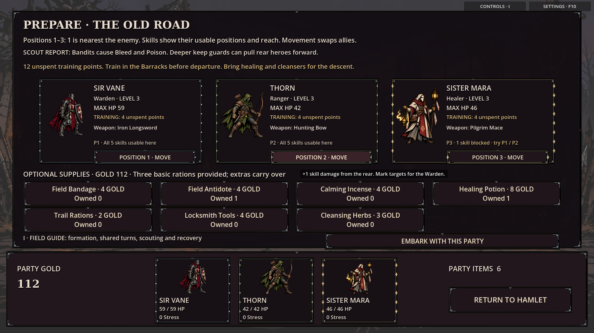
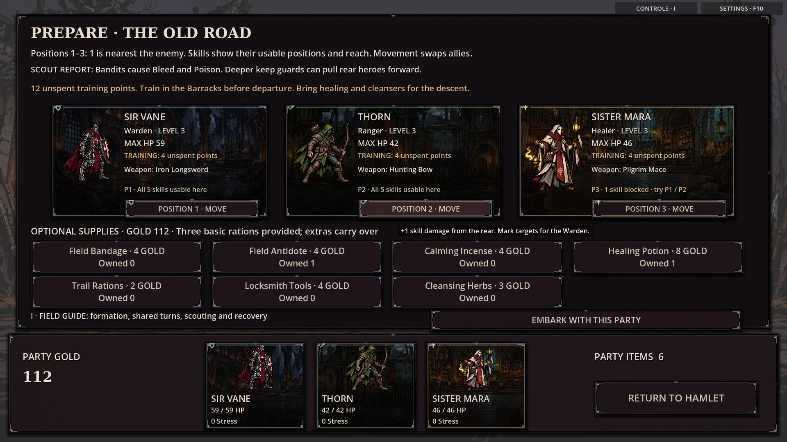
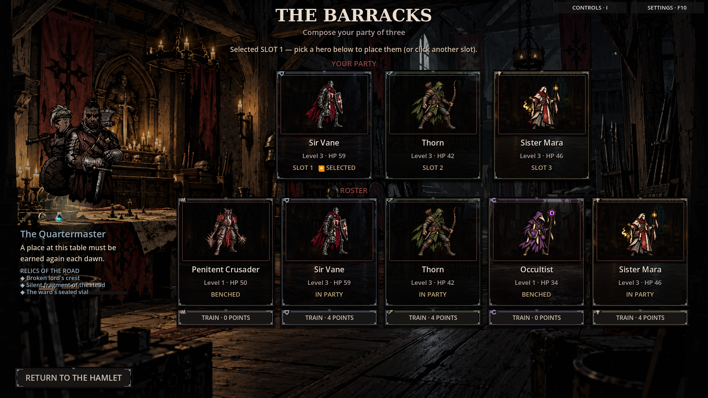

# Grimdark visual foundation — steps 1–2

The settlement now illuminates the structures already in the painting. All nine
hotspots have traced polygon hit areas and sample the original vista with matching
pixel coordinates. This removes replacement roofs, broad rectangular glows and
the floating graveyard sticker. A fine warm roof edge and one shared footer reveal
the selected building. Tab focus uses the same illumination as pointer hover.

Hero cards use class-specific illustrated settings, darkened toward the text,
with a single engraved class mark and a fine header rule. Large text surfaces and
small ability buttons use restrained charcoal grain instead of scenic imagery.
Shared tokens define ivory text, muted brass edges, two-pixel corners and soft
shadows. Character/inventory sheets, settings and the controls guide now explicitly
apply the same presentation as scene screens. Map artwork and combat actor slots
retain transparent overlays.

This implements the shared visual foundation, drawing on the reference's painted
town integration and grimdark hierarchy. It does not reproduce Darkest Dungeon's
complete layout or replace the existing character illustrations. Existing project
artwork supplies the card settings; this change adds no external artwork dependency.

## Screen audit

Captured 34 controlled states **before and after**, at both **1280×720** and
**1920×1080**: 136 PNG captures in total. The baseline was commit `b6da148`;
fixtures use isolated user-data directories and do not represent balance playtests.

| Family | Captured states | Finding / foundation change |
| --- | --- | --- |
| Entry | Title | Shared buttons, serif headings and restrained panel edges |
| Settlement | Idle, all nine building hovers, expedition transition | Matching vista samples; consistent captions; roof-shaped hit areas |
| Town services | Barracks, archive, forge, apothecary, shop, customization, keepsakes, restoration, graveyard | Shared materials and card trim; transparent barracks portrait backing |
| Departure | Regions, preparation | Scenic hero cards; map overlays remain input-transparent |
| Dungeon | Exploration, camp, event, merchant | Shared panel material without covering scenery or route controls |
| Global overlays | Character record, inventory, settings | Readable dark information panels; themed headings and controls |
| Combat / progression | Combat, relic reveal, descent warning, aftermath | Consistent card surfaces; grounded sprites and gameplay controls preserved |

The archive, keepsakes and graveyard captures include their fixture's empty/initial
states. Hover captures exercise each building separately. Screenshots establish
the shared skin and composition; they are not an exhaustive test of every item,
enemy, unlocked record or long player-entered name.

## Review images

| Before | After |
| --- | --- |
|  |  |
|  |  |



## Verification

Passed `visual_foundation_smoke`, `class_ui_smoke`, `visual_overlay_smoke`,
`static_screens_smoke`, `controls_guide_smoke`, `settings_saves_smoke`,
`save_validation_smoke`, and `boss_clarity_pacing_smoke`.

The foundation check verifies all nine highlight UV registrations, polygon rejection
outside a building, keyboard illumination, idempotent card decoration, container
underlay bounds, input transparency and unchanged gameplay RNG. Existing checks
cover optional-art fallback, map locks, interiors, hero switching, settings/save
actions and combat pacing. Native OpenGL captures completed without script or
shader errors. The virtual display reports an unsupported V-sync warning, and
the audit can report the project's existing shutdown resource-retention warning.
Validation used Godot 4.6.3, the engine available in the execution environment.

To reproduce captures with a graphical display:

```sh
godot --path . --audio-driver Dummy --script res://tests/visual_foundation_capture.gd -- /absolute/capture/directory 1920 1080
godot --headless --path . --script res://tests/visual_foundation_smoke.gd
```

Use an isolated `XDG_DATA_HOME` for the capture fixture, which constructs progression
and writes audit saves. Change the final dimensions to `1280 720` for the smaller
resolution.

## Next visual work

1. Redesign ability-card information hierarchy: descriptions and range markers are
   still too small at 720p, and character-sheet skill descriptions can be clipped.
2. Give roster portraits more space and develop higher-resolution portrait assets
   with a consistent light direction and silhouette treatment.
3. Paint a cemetery landmark directly into the existing courtyard: its service is
   reachable and named on hover, but the original town painting has no distinct
   gravestones after removal of the detached marker.
4. Refine merchant, archive and aftermath layouts, including longer content and
   additional empty, locked, selected and disabled states.
5. Develop UI scaling and a dedicated contrast/readability pass. The current 1920×1080
   logical canvas still scales smaller text down at 720p.

The same palette and surface component should guide those layout changes. Preserve
semantic status colors, keyboard focus and clear access to each service.
