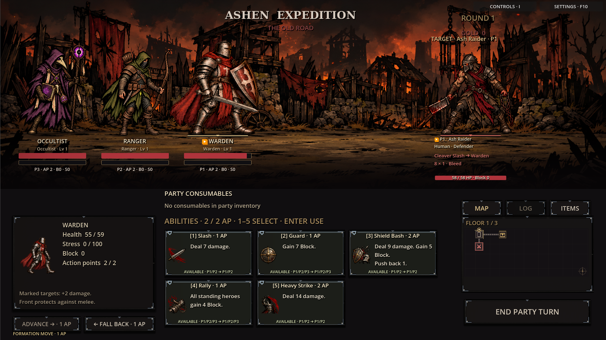
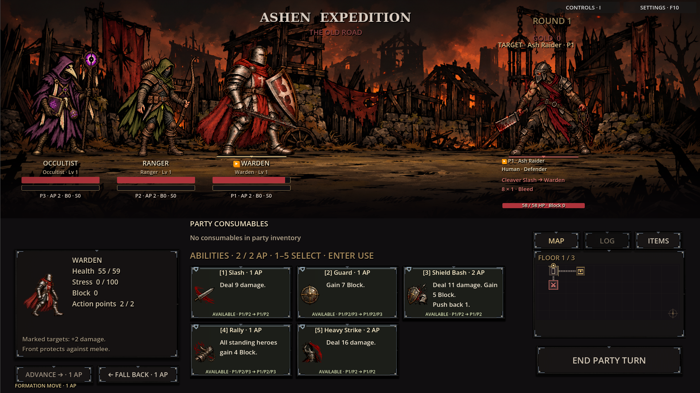
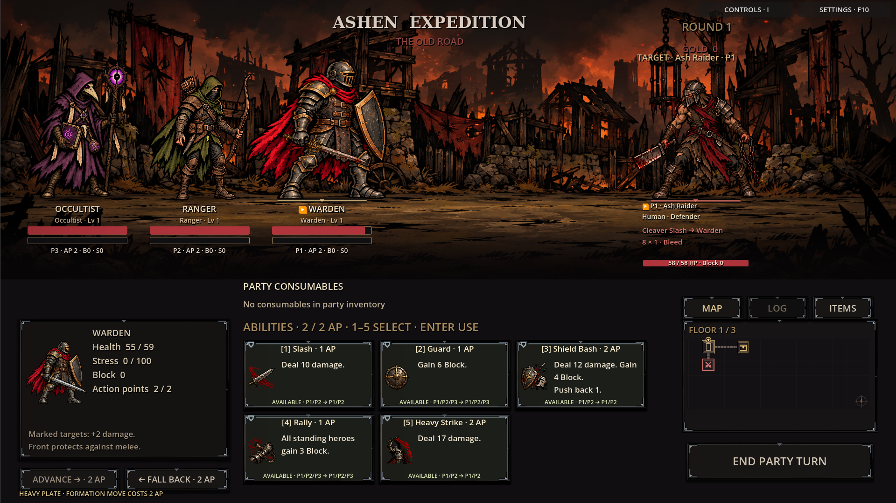
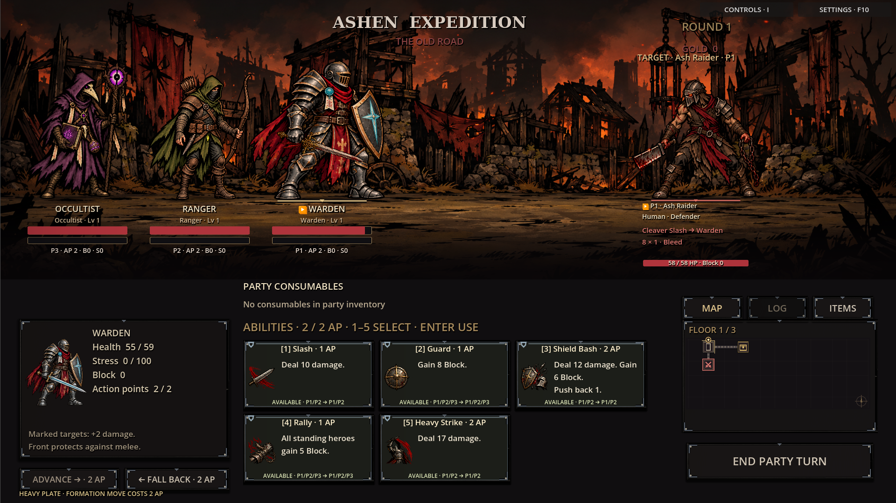
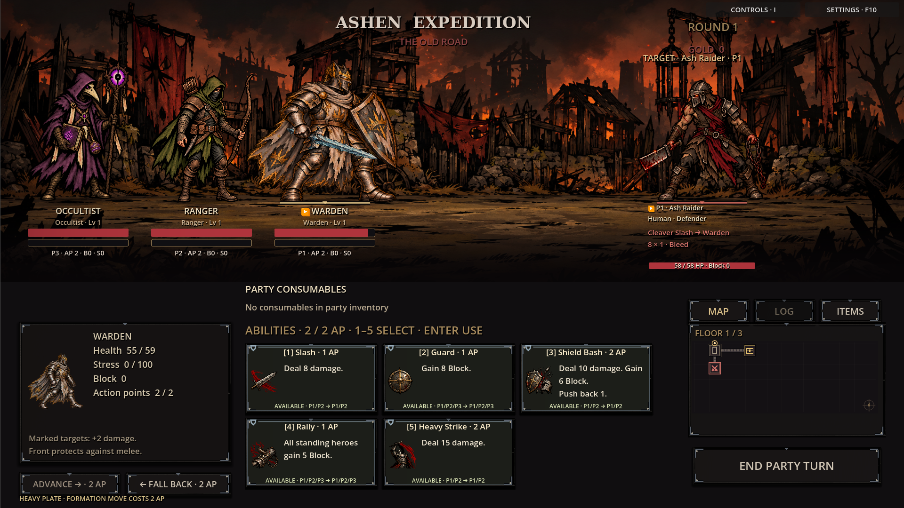
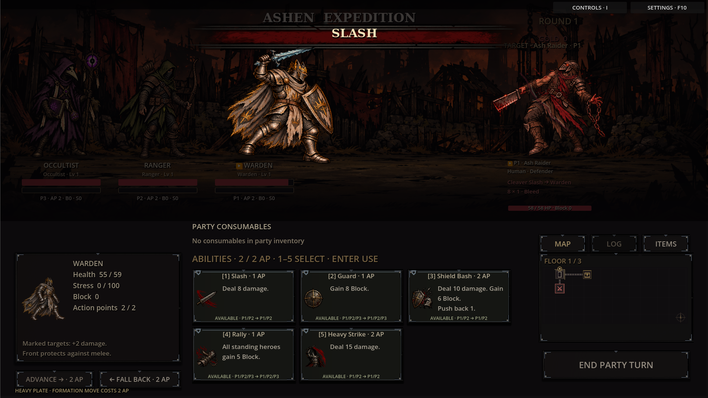

# Warden equipment-driven combat visuals

Equipping a Warden weapon now changes the held weapon in the actual combat scene,
including cinematic attack poses. The hand stays three-quarters up the handle.
The approved soft smoke and neon pixel sparkles follow intrinsic offensive weapon
properties; Vigil of Winter keeps its existing Chill chance, rather than guaranteeing a proc.

| Equipped weapon | Appearance | Persistent weapon effect |
| --- | --- | --- |
| Iron Longsword | Plain iron sword | None |
| Vigil of Winter | Jagged frost blade | Pale-blue smoke and pixel sparkles |
| Dreadsteel Longsword | Barbed dark steel and torn ribbons | None |
| Oathkeeper | Pale steel, golden sun-ring guard and ribbons | None |

The blood-coloured ribbons are artwork, not an added Bleed property.
Unequipping the weapon leaves the hand empty. Named/heirloom items resolve through
the existing base item ID. Original, Ashen Wolf, faction and relic armour all
retain their own body, shield and helmet. Oathkeeper no longer substitutes a
relic outfit when the Warden has chosen a manual outfit without equipped armour.
The existing armour selection and unlock rules otherwise remain in effect.

## Actual combat captures

## Armour and attack poses

Combat owns composite textures built from the body, held weapon, gauntlet mask
and effects. This lets the existing presentation, palette and status shaders
use one complete image. Cached poses retain the weapon captured for queued
attacks. Inactive composites stop rendering after initialization, and their
lifetime follows the combat actor. Dead heroes stop emitting weapon effects.
Visible foot rows and body heights keep the class build grounded and consistent.

This integration applies to the Warden's combat model. Other classes retain their
existing art pending their weapon integration. Travel and inspection portraits
continue using their existing costume art. Stats, attack effects, proc chances,
loot, progression and save schemas are unchanged.

Validation: **94 smoke checks** — 93 with the headless renderer, plus
`attack_profiles_smoke.gd` with native graphics for live-texture silhouette reads.
Checks include equipment swaps, all armour choices, named items, queued attack
snapshots, empty-hand unequip, death effects, scene transitions, class proportions,
existing combat mechanics and save/progression flows. Captures use the running
combat scene and the existing attack presentation.
