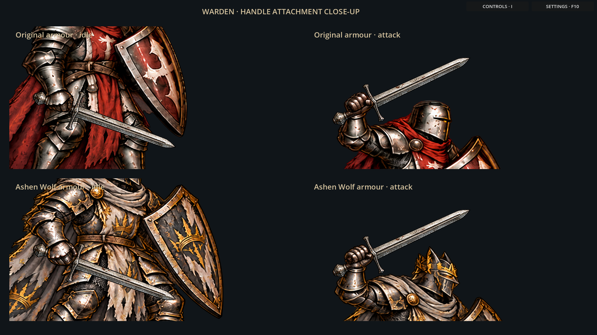
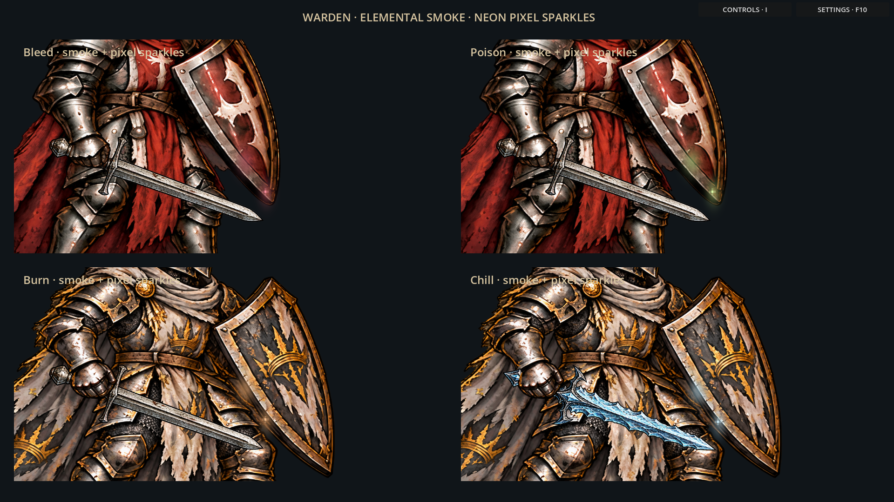

# Warden weapon preview

A separate, playable art study for the approved weapon customization approach.
The current game remains intact; this preview has not replaced live combat art.

## Compare weapons and armour

[](idle.png)
[](attack.png)
[](grip-closeup.png)

Both original and Ashen Wolf armour use a shared body per pose. The iron sword,
spiked mace and frost blade attach independently with the hand three-quarters up each usable handle, with
a gauntlet layer covering the handle. Weapon changes preserve the chosen armour,
shield and body proportions.

The sword and Vigil of Winter resolve to existing Warden catalog items. The mace
is a visual sample, not a new loot item. Other Warden weapons and other heroes
have not yet been authored for this approach.

## Soft elemental smoke and neon pixel sparkles

[](effects.png)
[Watch the smoke and pixel sparkles](wisp-closeup.gif).

[](wisp-closeup.png)

An intrinsic offensive weapon property produces a soft persistent wisp near its
blade/head: muted crimson for Bleed, sickly green for Poison, ember orange for
Burn, and pale blue for Chill. The existing Vigil of Winter demonstrates actual
catalog resolution. Bleed/Poison/Burn panels are explicitly labelled colour
samples; they do not add items, guarantee procs or change existing effects.
Two-pixel neon cores and tiny cross-shaped accents blink and drift inside the
smoke. The existing smoke strength, soft edges and movement remain unchanged.
There are only a few sparks, coloured to match the element; ordinary weapons
have neither smoke nor sparkles.

Resistance bonuses, temporary statuses and charms do not colour the weapon.
Motion obeys the game's ambient-motion setting.

## Run the interactive preview

Open `experiments/weapon_showcase.tscn` in Godot, or run:

```sh
godot --path . res://experiments/weapon_showcase.tscn
```

Use **Idle**, **Attack pose**, and **Element colours** to compare the six figures.
The standalone component is `experiments/warden_weapon_preview.tscn`.
It reads equipped item data through `configure_equipped`; no game progression,
save files, inventory or attack statistics are modified by the preview.

The revised preview uses gauntlet-shaped foreground masks instead of rectangular
patches, preventing surrounding armour from hiding the handle. Each pose has a
measured grip inside the actual gauntlet. Grip height is measured along the
usable handle between guard and pommel, rather than across the whole weapon. Wisps are wider and more visible than
the first preview, while retaining soft edges and slow movement. The focused
loop enlarges the actual effect without changing its shader strength.

Validation: 93 Godot smoke checks, including body preservation during swaps,
weapon silhouette changes, both attack grips, offensive-property filtering,
unknown item fallback and freezing motion. Independent review found no Critical
or Important issues. A native graphical check also compares smoke on/off against
the dungeon for all four colours, with a separate check that only a few bright
pixel sparkles appear when enabled. Captures were rendered in Godot.

Run the graphical check with a display available:

```sh
godot --path . --script res://tests/warden_weapon_wisps_visual.gd
```
