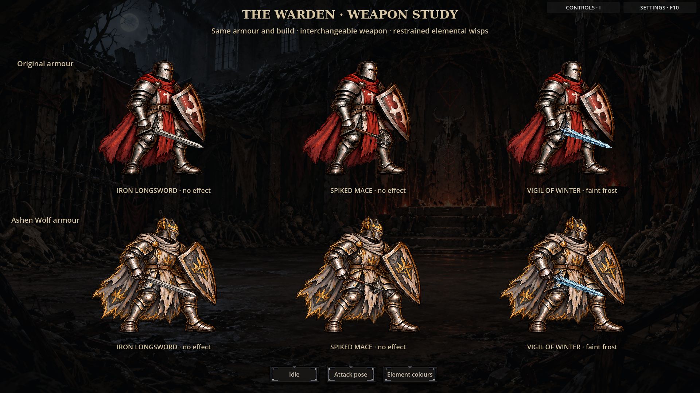
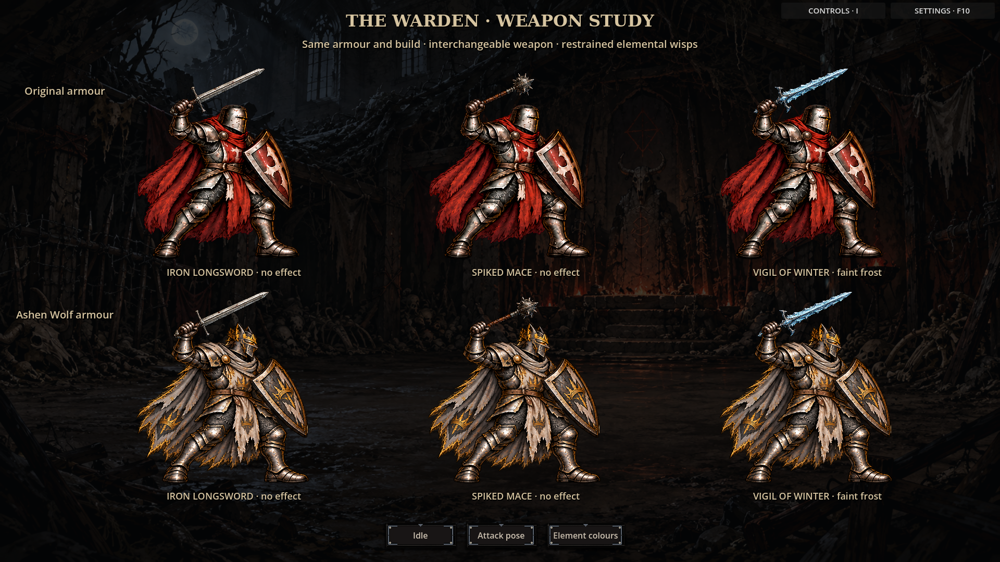

# Warden weapon preview

A separate, playable art study for the approved weapon customization approach.
The current game remains intact; this preview has not replaced live combat art.

## Compare weapons and armour

[](idle.png)
[](attack.png)

Both original and Ashen Wolf armour use a shared body per pose. The iron sword,
spiked mace and frost blade attach independently at measured hand grips, with
a gauntlet layer covering the handle. Weapon changes preserve the chosen armour,
shield and body proportions.

The sword and Vigil of Winter resolve to existing Warden catalog items. The mace
is a visual sample, not a new loot item. Other Warden weapons and other heroes
have not yet been authored for this approach.

## Restrained elemental wisps

[](effects.png)
[Watch the smoke animation](element-wisps.gif).

An intrinsic offensive weapon property produces a faint persistent wisp near its
blade/head: muted crimson for Bleed, sickly green for Poison, ember orange for
Burn, and pale blue for Chill. The existing Vigil of Winter demonstrates actual
catalog resolution. Bleed/Poison/Burn panels are explicitly labelled colour
samples; they do not add items, guarantee procs or change existing effects.
Resistance bonuses, temporary statuses and charms do not colour the weapon.
Motion obeys the game's ambient-motion setting.

## Run the interactive preview

Open `experiments/weapon_showcase.tscn` in Godot, or run:

```sh
godot --path . res://experiments/weapon_showcase.tscn
```

Use **Idle**, **Attack pose**, and **Element colours** to compare the six figures.
The standalone component is `experiments/warden_weapon_preview.tscn`.
It reads equipped item data through `configure_equipped`; no game progression,
save files, inventory or attack statistics are modified by the preview.

Validation: 93 Godot smoke checks, including body preservation during swaps,
weapon silhouette changes, both attack grips, offensive-property filtering,
unknown item fallback and freezing motion. Independent review found no Critical
or Important issues. Captures were rendered in Godot.
