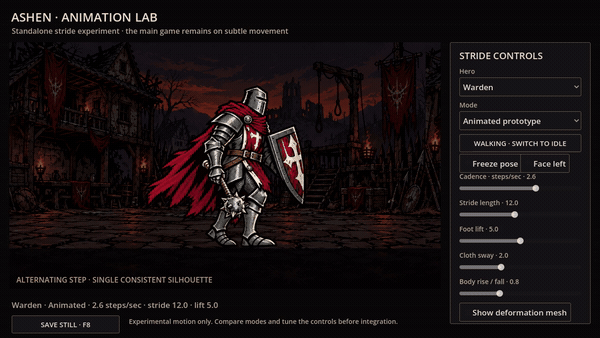

# Standalone walking animation lab

The shipped game stays on its current subtle hallway motion. This folder is a separate Godot project for reviewing a more animated walk before deciding whether to port it. The parent `.gdignore` keeps the experiment out of the main project's editor import scan and resource export scan. No production scripts, settings, saves, or live artwork are changed.



[Full-size 30 fps video](preview/animated-stride.mp4) · [Five-hero contact sheet](preview/heroes.png)

## Run the lab

Import **`experiments/animation_lab/godot/project.godot`** as a separate project in Godot 4.6 or newer, then press **F5**. Or, from the repository root:

```sh
godot --path experiments/animation_lab/godot --editor --import --quit
godot --path experiments/animation_lab/godot
```

The preview contains the Warden, Ranger, Occultist, Healer, and Crusader in their original outfits. Select a hero and compare these lab-only modes:

| Mode | Behavior |
| --- | --- |
| Animated prototype | One consistent pose with continuous alternating foot travel/lift, breathing, small body rise/fall, and delayed cloth sway |
| Subtle reference | The same consistent pose with breathing and small sway; a visual reference for the current game's approach |
| Original four frames | The existing four-pose loop, preserved here for comparison |

These choices are **not new player options in the game**. The subtle reference approximates the production motion in this standalone scene; it does not run the game's hallway code.

Adjust cadence (steps per second), stride length, foot lift, cloth sway, and body rise/fall. Walking/idle eases the stride amplitude, Freeze pose holds the motion, Face left reverses the silhouette, and Show deformation mesh exposes the cutout geometry. **F8** or **Save still** writes a PNG into this lab's own Godot `user://` folder, separate from game saves.

## How this prototype works

The five source sprite sheets and background are unchanged copies of assets from main-game commit `9f3f3af`. `actor_catalog.gd` records the original frame regions and per-hero leg masks. `actor.gd` draws a dense 24 × 36 mesh with atlas UVs inset to avoid sampling neighboring poses. `stride.gdshaderinc` moves the feet on alternating phases and keeps the face and upper-body identity consistent. Shader displacement creates continuous intermediate positions rather than jumping between the four independently illustrated poses.

This is a procedural cutout experiment, not a Spine rig or new hand-drawn animation. Limb overlap, planted-foot contact, and folds can still look elastic, especially at large strides. Held gear is part of the flattened image, so independent weapon or arm animation needs separated layers. Alternate/relic outfits and equipment overlays are outside this first prototype.

For the next iteration, review both extreme step poses and motion at game size, tune each hero's foot divider/weights, and decide whether to supply separated legs, cape, torso, and gear for a proper rig. No official port should happen until that visual review is accepted.

## Verify and reproduce previews

```sh
godot --headless --path experiments/animation_lab/godot --script res://smoke.gd
godot --path experiments/animation_lab/godot --script res://capture.gd -- /tmp/animation-lab-stills
godot --path experiments/animation_lab/godot --script res://capture.gd -- /tmp/animation-lab-movie movie
ffmpeg -framerate 30 -i /tmp/animation-lab-movie/frame_%04d.png -c:v libx264 -crf 20 -pix_fmt yuv420p -movflags +faststart /tmp/animated-stride.mp4
```

The smoke check covers all five heroes and all 20 source regions, mesh topology/UV bounds, refresh-rate independence, settled idle motion, freezing, comparison modes, and UI controls. The preview script records 13 seconds at 30 fps: walking, settling to idle, facing left and walking again, then facing right. The small GIF shows the first four seconds at 15 fps; use the MP4 or the running lab to judge fluidity.

Keep experimental edits here. Replacing one of this project's copied PNGs changes the lab only; porting approved assets or motion to the game's art library and hallway renderer remains a separate change.
