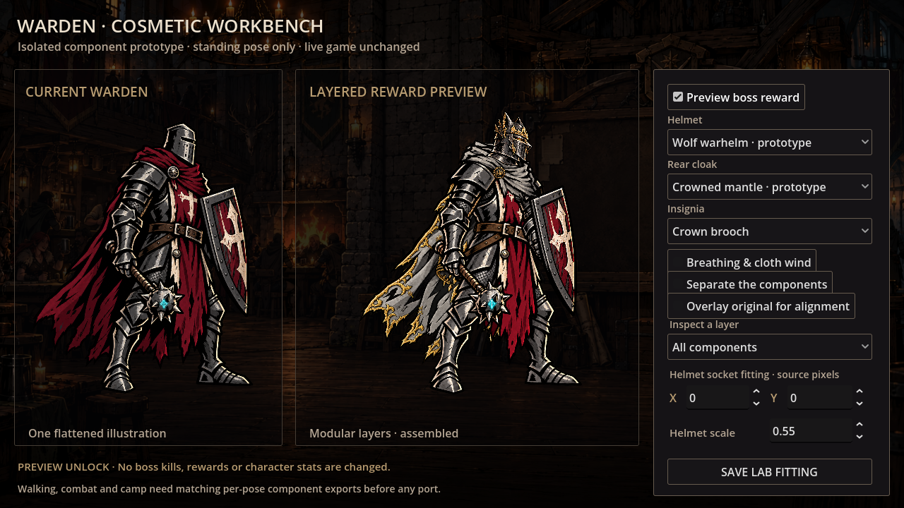
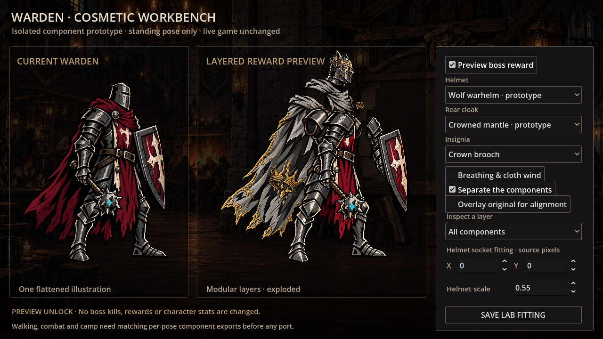
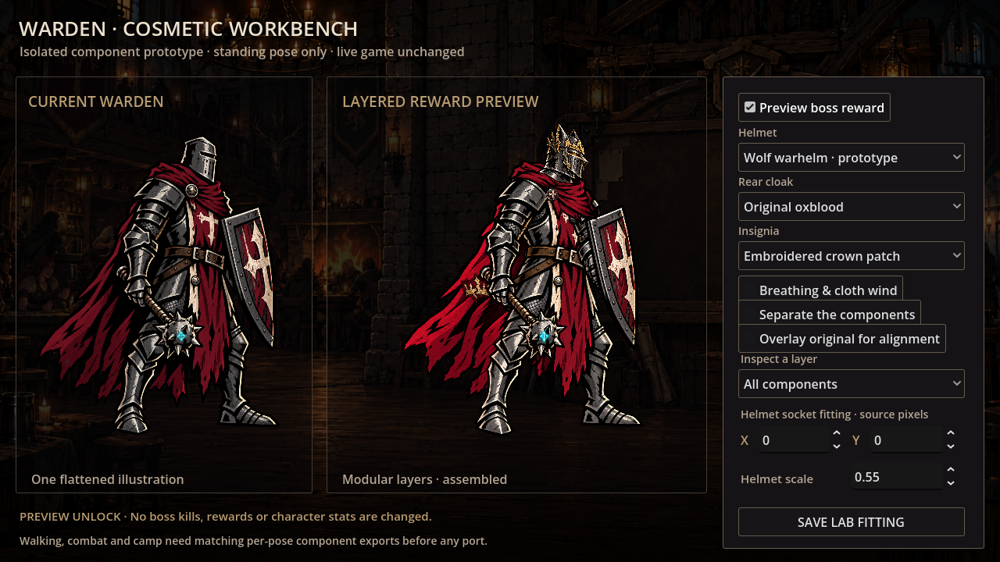

# Warden cosmetic component prototype

Standalone visual experiment. **Nothing is integrated into the game:** the live Warden, original walking, Workshop choices, boss rewards, saves, and guild hall remain unchanged. The parent `.gdignore` excludes this project from the main game's editor/import/export resource scan.



## What to review

The current flattened Warden is shown beside an assembled model with independently swappable greathelm, rear cloak, and insignia. The reward concept is a corrupted **Wolf Warhelm**, an ash-grey, gold-embroidered **Crowned Mantle**, and a crown brooch or embroidered patch. The warhelm replaces the earlier crown-on-greathelm concept with a predatory metal visor, fang-like cheek guards, jagged forged ears, and tarnished relics integrated into the armor. Its wolf motif follows the ruined keep's wolf banners and the last son's beastlike corruption. The reward mantle and its neck wrap use weathered warm grey, echoing the boss's pale revenant details while retaining aged-gold trim. These are appearance studies for the Undying Lord, not actual unlocks or stat equipment.

The **Preview boss reward** checkbox simulates availability within this lab only. Turning it off restores ordinary parts and disables reward choices. Compare different combinations, inspect a single layer, overlay the original to check alignment, or separate the components to see the construction.



There are seven independently rendered layers/attachments:

1. Rear cloak: a deformable mesh behind the body.
2. Optional embroidered patch: attached to the cloak, using the same source coordinates, transform, and deformation material.
3. Underpainted torso/legs: armor and tabard with hidden shoulder/neck overlap.
4. Arms/gear: armored arms, gauntlets, mace, and shield.
5. Front scarf: drawn over the shoulder armor.
6. Helmet: positioned through a neck socket and image joint.
7. Shoulder insignia: its own clasp attachment.

**Breathing & cloth wind** tests small, foot-anchored breathing and independent cloth deformation. A patch follows the fabric rather than floating over it. Choose the original cloak plus embroidered patch to evaluate this separately from the mantle's baked gold embroidery.



[Watch the native 30 fps cloth/patch clip](preview/cloth-patch.mp4) · [Ordinary modular assembly](preview/stock.png) · [Patch-only inspection](preview/patch-only.png)

## Run and save a fitting

Import **`experiments/warden_cosmetics/godot/project.godot`** as a separate Godot project (4.6 or newer), then press F5. From the repository root:

```sh
godot --path experiments/warden_cosmetics/godot --editor --import --quit
godot --path experiments/warden_cosmetics/godot
```

Helmet X/Y and scale controls let us inspect the neck fit without editing pixels. **Save Lab Fitting** writes `user://warden_cosmetic_fitting.json` in this project's own user-data folder; the console prints its full path. The export contains prototype-only identifiers and socket values, not campaign or achievement data. It is a design export, not an automatic import into the game.

## Artist kit and alignment

All source PNGs live in **`godot/assets/`**. The original Warden and room are byte-identical copies from main-game commit `5782f68`. The body, arms/gear, scarf, cloak, reward cloak and matching grey scarf, corrupted warhelm, and component sheet were generated/edited with the session's OpenAI image tool. Original output pixels are preserved unchanged; Godot applies fitting transforms when rendering.

- `sources.json` records dimensions and SHA-256 hashes.
- `components.json` records layer order, texture regions, source-space sockets, and the patch's cloth attachment.
- `alignment.json` records per-layer affine registration to the original 1247 × 1261 canvas. Image-feature analysis supplied initial fitting; native screenshots were used to review the result. Running the lab does not require Python or OpenCV.
- `components.png` is a transparent 1536 × 1024 sheet: stock helmet, earlier crowned helmet study (retained but unused), iron clasp, crown clasp, embroidered patch, and a spare company pin in 512 × 512 cells.

- `corrupted_warhelm.png` is the separate active reward helmet; the internal `crown` variant ID is retained for existing lab fitting exports. Its canvas is normalized to 512 × 512 at render time, with the neck joint at (280,470).

For hand-drawn replacements, keep the corresponding PNG's existing canvas, transparency, and part position. If you instead redraw directly on the canonical 1247 × 1261 reference canvas, replace that layer's registration matrix with identity in `alignment.json`. Keep hidden overlap beneath collars, shoulders, and equipment so seams do not open when layering. Helmets should share a neck joint rather than being scaled by their total bounds: a taller crown should grow upward without shrinking the faceplate.

This is **AI reconstruction plus fitting**, not a lossless pixel separation of the original artwork. Some folds and underlying armor were repainted during extraction. Artist cleanup is still appropriate before production use.

## Practical limits and next step

Only **one standing pose** is covered. The wind test is not a new walking animation. Torso/legs and arms/gear remain compound drawings; individual greaves, gauntlets, chest plates, weapons, and shields need further separation if we want those slots to be freely interchangeable.

The existing walking and combat sprites have different proportions and occlusions between poses. This standing helmet/cape cannot simply be pasted onto every frame. The next useful art pass is one walking pose plus one attack pose, each with matching body layers, sockets, and draw order. Review neck/shoulder seams and helmet/cape readability at actual game size before expanding the full pose set.

For a later full cutout rig, split upper/lower limbs at joints, draw their hidden surfaces, and bind attachments to explicit bones/sockets. A Spine or Godot bone rig would be a separate implementation; this project is not a Spine export. Permanent boss-unlocked ownership and online cosmetic-ID synchronization also remain future work.

## Verification

The smoke check exercises independent swaps, simulated reward locks, source overlay, layer inspection, exploded assembly, helmet socket fitting, shared cape/patch deformation, stopped motion, and prototype-only JSON export. Source hashes confirm copied reference art is unchanged, and generated parts preserve alpha transparency. Native previews were captured at 1280 × 720; the motion clip is five seconds at 30 fps.

```sh
godot --headless --path experiments/warden_cosmetics/godot --script res://smoke.gd
godot --path experiments/warden_cosmetics/godot --script res://capture.gd -- /tmp/warden-stills
godot --path experiments/warden_cosmetics/godot --script res://capture.gd -- /tmp/warden-movie movie
ffmpeg -framerate 30 -i /tmp/warden-movie/frame_%04d.png -c:v libx264 -crf 20 -pix_fmt yuv420p -movflags +faststart /tmp/cloth-patch.mp4
```
