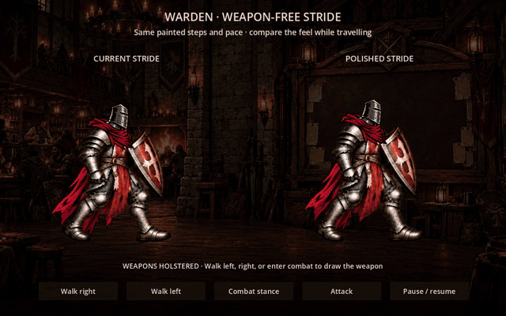
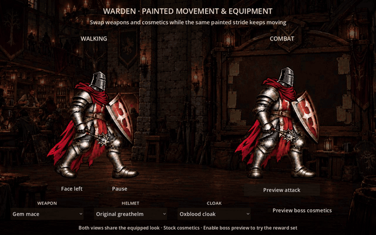

# Warden painted movement and equipment

## Weapon-free stride polish

The latest trial keeps the same ten body drawings and 0.84-second stride. It
removes the visible weapon during travel and corrects the per-frame upper-body
registration: the original neck attachment drifted 11 source pixels sideways
and 22 pixels vertically. The polished view holds the neck alignment steady,
adds only a small continuous bob, and scales each body frame slightly vertically
around the planted boot baseline. Helmets and cloaks keep their original size.
No source image was repainted for this pass.



[Native 30 fps comparison](preview/weapon-free-stride.mp4)

The default scene is now the stride comparison: current fitting on the left,
polished fitting on the right. Both views holster the weapon while walking.
Controls let you travel left/right, pause, enter armed combat idle, and play the
held attack. Their clocks and travel speed match for comparison. The recorded
clip includes left and right travel, drawing the mace for combat, attacking and
returning to weapon-free travel.

This pass reviews the original outfit's movement only. Complete boss-reward
armor-set artwork and campaign reward integration are not implemented here.
The original equipment workbench remains available as `godot/lab.tscn`; its
walking view now also holsters the weapon. The older equipment clip below was
captured before the stride-polish pass.

```sh
godot --headless --path experiments/warden_painted_equipment/godot --script res://stride_smoke.gd
```

This checks hidden weapons through all walking poses and swaps, stable neck
registration, planted boot baselines, preserved loop timing, drawing the equipped
weapon in combat and attack, and weapon-free leftward travel. Existing equipment
and graphical cloak checks continue to apply.

## Earlier equipment-swap trial

A standalone trial combining the approved ten-frame painted movement with
separate weapons, helmets and cloaks from this repository's existing experiments.
The main game is unchanged; `.gdignore` isolates this nested Godot project.



The sixteen-second clip shows stock equipment, a mace-to-axe swap, the Wolf
Warhelm, the Crowned Mantle, mixed cosmetics, both held attack poses, left facing,
and a return to stock cosmetics. Walking and combat share one appearance profile.
Equipment swaps keep the current animation phase.

[Watch the native 30 fps clip](preview/equipment-swaps.mp4) for a clearer view of
the stride and fitting; the looping GIF is reduced to 20 fps and 640 pixels wide.

## Run

Import `experiments/warden_painted_equipment/godot/project.godot` as a separate
Godot 4.6+ project and press F5. No plugins or Spine runtime are needed.

```sh
godot --headless --editor --path experiments/warden_painted_equipment/godot --import
godot --path experiments/warden_painted_equipment/godot
```

Select a mace or axe. Enable **Preview boss cosmetics** to make the Wolf Warhelm
and Crowned Mantle selectable independently. **Preview attack** holds the raised
combat pose briefly, then returns to breathing. Pause freezes movement and cloth;
Face left mirrors the complete walking character, including equipped items.

The reward checkbox is a simulated availability flag, not a boss kill or an
inventory grant. Disabling it restores ordinary helmet/cloak choices and keeps
the selected weapon. Nothing writes campaign saves or changes item stats.

## How the artwork works

- The body uses ten walking poses, one combat idle and one held attack pose.
  Arms, legs, armor, front tabard and shield are painted into these frames.
- Helmet, rear cloak, neck wrap and weapon are independent draw layers.
- Each painted pose has explicit neck and gripping-hand coordinates, with a
  boot baseline that keeps the character grounded.
- A small copied gauntlet region draws in front of the weapon handle to preserve
  the grip. Equipment does not rotate the painted limbs.
- Idle breath lifts the upper body subtly with the neck and weapon following.
  The rear cloak uses a separate cloth mesh with restrained movement.

This uses flipbook movement with attachment sockets, not the articulated
movement from `warden_rig`. Weapons are held forward in idle and walking.
The established IDs are reused: `mace`/`axe`, `original`/`wolf`, and
`original`/`crown`. The shield remains painted in; this trial does not offer a
free-offhand or sword option.

`godot/assets/sources.json` records the provenance and SHA-256 hashes of every
image. The weapon atlas, helmet components, wolf warhelm, cloak variants, neck
wraps and room are byte-identical copies of the existing experiment assets.
The new body atlas was reconstructed from the approved painted sheet with the
head, cape and weapon removed using the image tool; its pixels are unchanged
after generation. This is not a lossless separation of the original Warden.

## Review and limits

[Stock equipment](preview/stock.png) · [Reward cosmetics and axe](preview/reward.png)
· [Held axe attack](preview/attack.png)

The old cosmetic/weapon assets have a stronger inked outline than the new body.
Socket fitting and hidden overlaps are prototype art; inspect neck/hand seams
and frame-to-frame armor details before production cleanup. Ten independently
painted leg poses can still vary in detail. Adding another weapon family may
need a different grip or combat pose, not just a texture replacement.

Only Warden artwork is authored here. Integration with actual equipment,
campaign unlock ownership, Workshop previews, saves, combat resolution and other
heroes is a later step after this visual approach is accepted.

## Verification

```sh
godot --headless --path experiments/warden_painted_equipment/godot --script res://smoke.gd
godot --path experiments/warden_painted_equipment/godot --script res://render_smoke.gd
```

The behavior checks cover reward locks, independent equipment textures,
unchanged painted pose/stride phase, all ten walk frames, weapon hand registration,
mid-attack swaps, return to idle/breathing, unknown-ID rejection, reward reset and
complete-actor mirroring. The graphical check proves the cloak renders above an
opaque room background; it requires a display.

To reproduce the recording at native 30 fps:

```sh
godot --path experiments/warden_painted_equipment/godot --script res://capture.gd --write-movie /tmp/warden-equipment.avi --fixed-fps 30 --quit-after 480 --audio-driver Dummy
```
