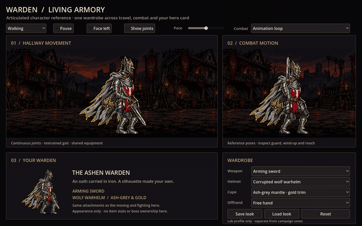
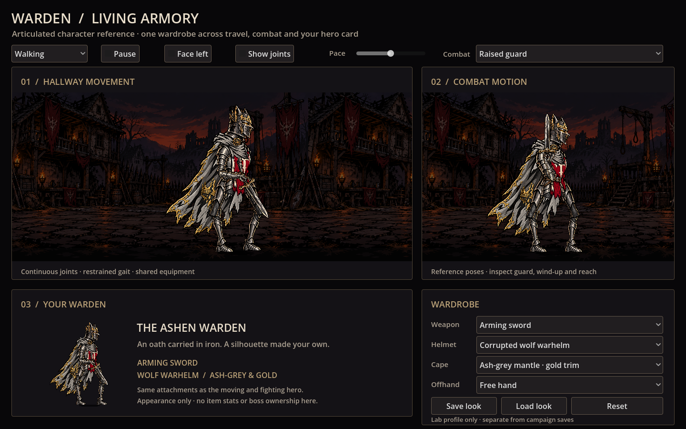
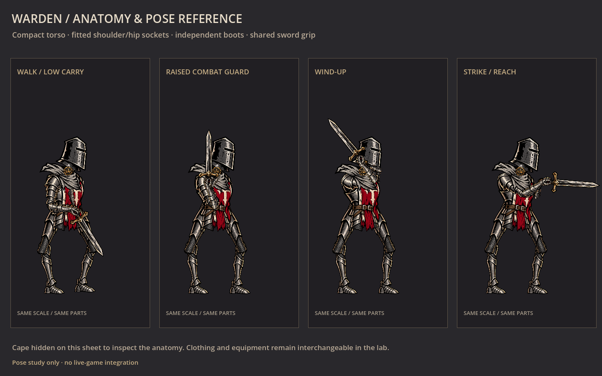
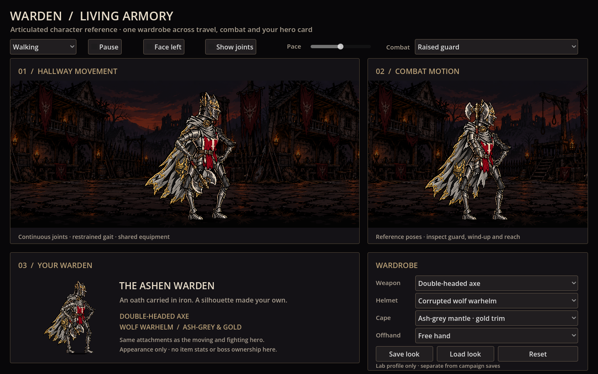
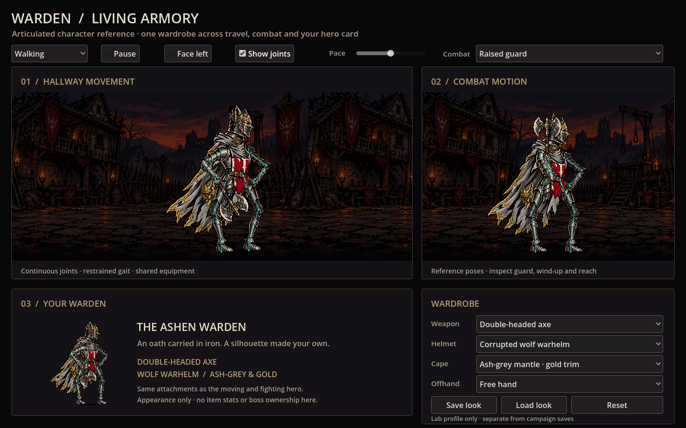

# Warden Living Armory — articulated reference

An isolated Godot prototype for a hero whose equipment stays recognizable while walking, attacking and appearing on their card. **The live game and both previous experiments are unchanged.** The parent `.gdignore` excludes this standalone project's resources from main-game imports/exports.



The quick preview is reduced to 15 fps; use the [native 30 fps clip](preview/articulated-warden.mp4) to judge the movement.



The anatomical revision follows the supplied combat and walking references: a shorter/narrower torso, fitted shoulder and hip pivots, wider planted stance, shorter steps, separate boots kept level, and gripping forearms drawn in front of the neck wrap.



[Walking phase sheet](preview/walking-phases.png) · [Anatomical joint overlay](preview/anatomy-joints.png)

Choose an **arming sword**, **double-headed axe**, or **gem mace**. Every selection immediately updates all three views through one shared appearance profile, without restarting their motion. The original greathelm and corrupted wolf warhelm remain interchangeable, as do the original oxblood cape and ash-grey mantle with gold edging. The matching neck wrap and clasp follow the cape selection. **Offhand** selects a free hand or kite shield across all three views. With a free offhand, the sword uses the two-handed raised guard from the reference; its far arm is foreshortened for this three-quarter projection.



## What changed from the older animation experiments

This is a **hierarchy of articulated cutouts**, not a deformation of a single flattened picture and not a four-image flipbook. Upper and lower arms and legs have their own joint transforms. Weapons are separate artwork registered to a gripping-hand socket; the shield is attached to the other hand. Head, torso, waist, cloak, scarf and clasp have independent drawing layers.

Walking uses a two-link limb solver and a repeating stance/swing foot path. The stance foot moves backward at the corridor's scrolling speed; the swing foot lifts slightly and returns forward. Position and velocity meet at both ends of the loop. Small torso movement, head counter-rotation and deformable cape mesh add secondary motion. Walking eases into standing, while **Pause** freezes both actors and travel. **Face left** mirrors the walking rig. **Pace** controls movement and animation together. The forearms overlap the scarf when gripping at chest/head height, and a recovery arc keeps the second hand from crossing its own shoulder.

The combat selector can hold **Raised guard**, **Wind-up**, or **Strike / reach**, or play an illustrative attack and recovery loop. This does not implement combat damage, attack targeting, item stats or two-handed weapon rules. The hero card uses another instance of the same rig at a smaller size; it reflects the selected visible equipment rather than a separate outdated portrait.



[Watch the nine-second native motion and equipment-swap clip](preview/articulated-warden.mp4) · [Original helmet/cape combination](preview/stock.png) · [Gem mace](preview/mace.png)

## Run

Import **`experiments/warden_rig/godot/project.godot`** as a separate Godot project, then press F5. Requires Godot 4.6 or newer, without plugins or additional runtime dependencies.

```sh
godot --path experiments/warden_rig/godot --editor --import --quit
godot --path experiments/warden_rig/godot
```

**Save look** and **Load look** use `user://warden_rig_profile.json` in the lab's own **Ashen Warden Articulation Lab** user-data directory. This stores schema-1 prototype-only hero/weapon/helmet/cape/offhand identifiers. Unsupported schemas, malformed content and unknown selections leave the current look intact. Earlier three-slot exports retain their implicit shield when imported. These are lab exports, not campaign saves, real inventory or unlocked rewards. Changes remain local; no multiplayer protocol is implemented.

## Artist replacement kit

All active source PNGs are under `godot/assets/`, with dimensions, source notes and SHA-256 hashes in `sources.json`. `original.png` is a reference image only. Source outputs are preserved unchanged; fitting is performed by Godot.

- `body_parts.png`: loose 3 × 3 arrangement: torso, waist, near thigh; far thigh, near shin, far shin; near boot, far boot, spare plain chest. Only the eight named attachments are active.
- `arm_parts.png`: four separate cutouts, ordered near upper arm, near forearm/hand, far upper arm, far forearm/hand.
- `gear_parts.png`: 2 × 2 cells, ordered shield, sword, double-headed axe, mace. No weapon is baked into an arm or hand.
- Helmet, cape, scarf and clasp images are unchanged copies of the current cosmetic study.
- `attachments.json` records actual source-pixel regions, anchors, segment endpoints, limb lengths, and attachment sockets. Regions follow the real cutout bounds rather than assuming equal cells. `alignment.json` supplies registration for the existing cape/scarf source canvases.

For a hand-drawn replacement, preserve each source region’s dimensions and local anchor/end positions. Paint hidden overlap around shoulders, elbows, hips and knees. Limb art is aligned from its anchor to its endpoint, so neighboring pieces can rotate without needing matching full-character drawings. Weapons should share a grip attachment contract; the sword provides a two-hand grip reference, while other two-handed or dual-wielded families still need their own pose and attachment information.

The Node2D hierarchy is a Godot cutout rig with analytic limb articulation. It is **not a Spine skeleton/export**, and the new parts are AI reconstructions rather than a lossless separation of the original. Boots now have independent ankle pivots and flat sole orientation; forearms still include gauntlets. Helmet fitting retains its original normalized 512 × 512 neck joint at (280,470). These pieces and their sole contact, armor overlaps and changing occlusion need artist cleanup before production. Full attacks, back-facing views, other heroes and every possible equipment combination have not been authored. The neutral pose sheets hide the cape to make the limb structure visible; the cape remains equipped in the lab.

## Future integration boundary

The reference proves the same appearance IDs can drive moving, fighting and card views. A later live implementation should separate equipment rules from their visual attachments, validate ownership, and load pose/grip profiles for weapon families. Online parties should synchronize validated appearance IDs, then reconstruct the same rig locally. Campaign unlocks and Steamworks remain separate work.

## Verification

`smoke.gd` covers shared selections, unknown-ID and future-schema rejection, atomic imports, hand-grip registration for all three weapons in every view, animation phase preservation during swaps, articulated knees, reachable foot targets, loop continuity, refresh-rate independence, walk-to-idle easing, pause, facing and isolated profile round trips, legacy offhand imports, anatomy proportions, level boots, and both hands reaching the sword grip throughout walking, guard, wind-up, strike and the full attack loop. Native screenshots were inspected at 1440 × 900. The capture clip contains 270 frames at 30 fps, with sword/axe/mace changes, a pause, and reversed travel.

```sh
godot --headless --path experiments/warden_rig/godot --script res://smoke.gd
godot --path experiments/warden_rig/godot --script res://capture.gd -- /tmp/warden-rig-stills
godot --path experiments/warden_rig/godot --script res://capture.gd -- /tmp/warden-rig-poses poses
godot --path experiments/warden_rig/godot --script res://capture.gd -- /tmp/warden-rig-movie movie
ffmpeg -framerate 30 -i /tmp/warden-rig-movie/frame_%04d.png -c:v libx264 -crf 20 -pix_fmt yuv420p -movflags +faststart /tmp/articulated-warden.mp4
```
