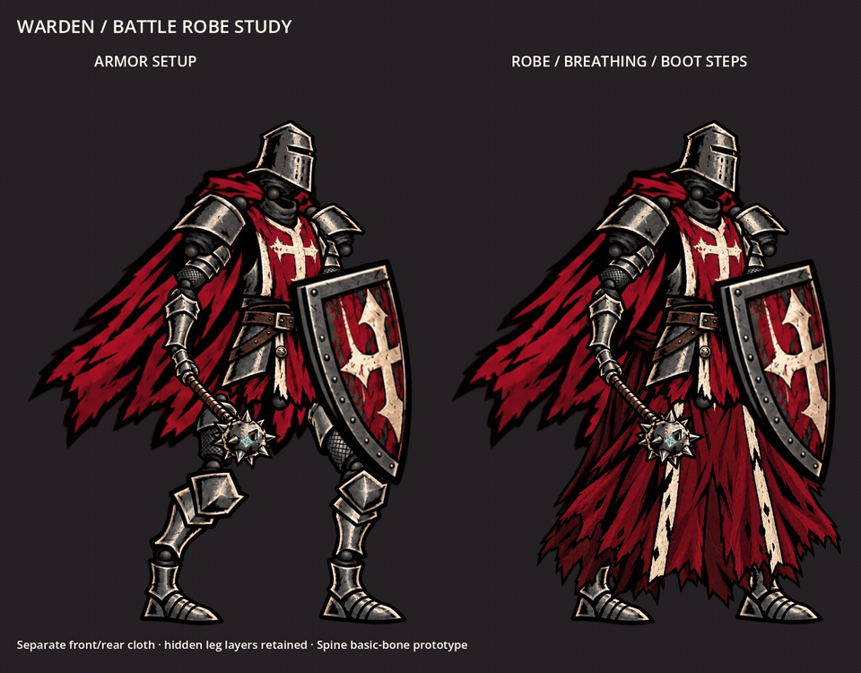

# Warden battle-robe prototype

An optional **Spine 4.3** variant with a heavy split front robe, darker rear cloth, visible boots, subtle upper-body breathing and restrained cloth sway. This remains an isolated experiment: the live game and the original armored Spine handoff are unchanged.



[Download robe Spine pack](warden-robe-spine.zip) · [Comparison video](comparison.mp4) · [Setup comparison](preview.png) · [Individual images](images)

## Layers and movement

The pack contains **22 transparent images and 23 basic bones**. Twenty original Warden cutout PNGs are preserved byte-for-byte. Two new generated layers, `robe_front` and `robe_rear`, attach beneath the belt and hip armor. The darker inner/rear cloth hangs slightly lower toward the trailing leg, with draw order above the boot caps and behind the decorated front panel. It fills the split and covers the ankle caps while the boot soles remain visible.

Thigh and lower-leg attachments are hidden in the robe setup, with their bones and images retained for editing. To restore the armor setup, show those four attachments and hide both robe slots. The existing armored pack remains the recommended separate starting point for exposed-leg animation.

Select **`breathing_walk`** in Spine to play the **2.4-second** demonstration: two small 1.2-second boot-step cycles, a slower chest breath, a slight head response, and independent front/rear cloth sway. The pelvis has a restrained weight shift. Foot timelines cancel that shift during contact so the planted boot pivots stay at their setup height. This is an in-place stylized movement study, not a finished locomotion cycle or an in-game animation mode.

The robe uses rigid image-region layers with basic transform keys. No weighted meshes, IK, physics constraints or Professional-only authoring features are required by the data. The folds do not deform internally, and extreme movement may expose unfinished overlaps. Hidden legs are suppressed, not physically solved underneath the cloth. Cloth/boot clearance and silhouette still need visual acceptance in your editor before a game port.

## Open in Spine

1. Download and extract the ZIP, keeping `images/` beside `warden-import.json`.
2. Check **Help → About**. The starter targets **4.3**; a different major/minor version needs a compatibility check.
3. Choose **Import Data**, import `warden-import.json` at scale **1**, and set Images to the extracted `images/` folder if needed.
4. Inspect the setup, select `breathing_walk`, and scrub the loop. Save a native `.spine` project in the extracted folder.

The official 4.3 runtime reads and evaluates the animation here. Import, save and re-export in your licensed desktop editor have not been performed. This JSON handoff is not a native `.spine` project.

## Replace or customize cloth

`images/robe_front.png` and `images/robe_rear.png` are independently replaceable, with waist anchors and registration recorded in `parts.json`. Keep canvas dimensions and `source_pivot_pixels` when hand-drawing replacements, or adjust the attachment transform in Spine if those change. The original generated robe sheet is preserved in `source/robe_panels.png`. The reference and armor source data are also preserved, so the pack is self-contained.

## Verification and rebuilding

The GIF/video uses **official-runtime-decoded animation geometry**, rendered natively in Godot. It does not use a separately approximated animation. The still shows armor on the left and the robe variant on the right.

```sh
python experiments/warden_robe/tools/build_variant.py
godot --headless --audio-driver Dummy --path experiments/warden_robe/tools \
  --script res://export_panels.gd -- /absolute/path/to/experiments/warden_robe
node experiments/warden_robe/validate.mjs \
  /absolute/path/to/experiments/warden_robe \
  /absolute/path/to/scratch/node_modules/@esotericsoftware/spine-core
python experiments/warden_robe/verify_images.py
python experiments/warden_robe/verify_coverage.py
godot --audio-driver Dummy --path experiments/warden_robe/tools \
  --script res://capture.gd -- /absolute/path/to/experiments/warden_robe /absolute/capture-output
```

Runtime validation uses `@esotericsoftware/spine-core@4.3.13` outside the game and checks image/source hashes, all setup joints and attachment centers, hidden-leg slots, actual breathing/stride movement, grounded contact pivots and loop closure. Image verification checks unchanged original art and lossless robe extraction. Coverage verification maps the actual cloth alpha silhouette over both transformed ankle-cap regions across all 72 decoded poses, checks layer order, and confirms that the boot soles remain visible. The capture exports 72 frames at 30 fps. These checks establish data correctness, not final animation quality.

Rebuilding overwrites generated starter data. Preserve your hand-edited project and image replacements separately before using the authoring tools.
