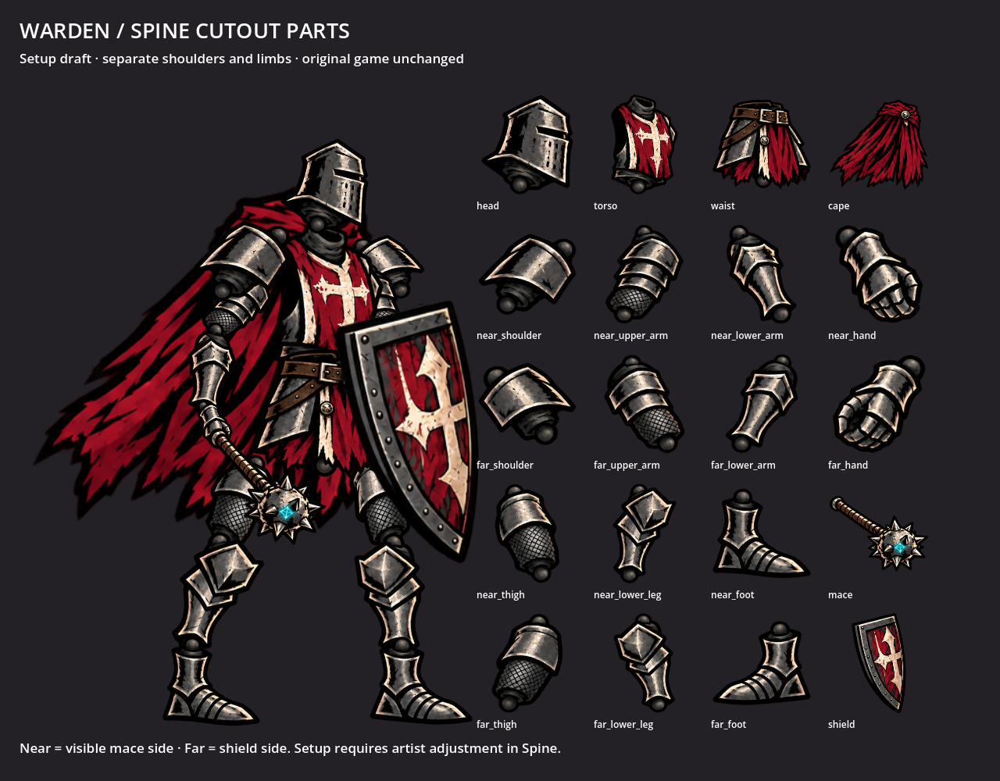

# Current Warden — Spine cutout parts

Twenty separate transparent PNGs based on the current red-cloaked in-game Warden, with a basic **Spine 4.3 JSON import starter**. This is a new art handoff, separate from the older Warden blockout and the walking-frame experiment. The live game is unchanged.



[Download the parts and Spine starter](warden-spine-parts.zip) · [Individual PNGs](images) · [Transparent setup draft](setup-preview.png)

## Included layers

- Head/helmet, torso, waist/pelvis and cape.
- Near and far shoulders, upper arms, lower arms and hands.
- Near and far thighs, lower legs and feet.
- Mace and shield, independently replaceable.

**Near** is the visible mace side; **far** is the shield side. The limbs have dark overlapping joint caps to prevent gaps during small rotations. Shoulders are separate from the chest and upper arms. Feet are separate from the shins. The starter mirrors the far-foot attachment horizontally to face the reference direction; its source PNG remains unmodified.

The source game sprite is flattened. These parts are **AI-reconstructed**, not recovered original paint layers or pixel-identical copies of the game sprite. Hidden far limbs and covered joint surfaces were inferred. The assembled setup is an alignment draft: adjust proportions, overlap, pivots and draw order in Spine before authoring a walk. Joint caps should sit behind neighboring plates; large rotations may expose unfinished surfaces. No finished walking animation is included.

## Open in Spine

1. Download and extract the ZIP. Keep `images/`, `parts.json` and `warden-import.json` together.
2. Check **Help → About**. This starter targets the **4.3** import format; it has not been opened in your licensed editor here.
3. Choose **Import Data**, select `warden-import.json`, use scale **1**, and import into a new skeleton.
4. Set the skeleton's Images path to the extracted `images/` folder if needed, then save a native `.spine` project beside it.
5. Check each named bone and attachment against `parts-preview.png`. Align the shoulder, elbow, wrist, hip, knee and ankle pivots before animating. The setup uses basic bones and image regions, with no weighted meshes, IK or physics constraints, to suit the Essential/basic workflow.

If your editor uses a different major/minor release, the format must be checked against that release; editing the version label alone does not establish compatibility. Desktop import and save/export still require verification in your editor.

## Hand-drawn replacements and future customization

Replace an individual `images/<part>.png` while preserving its canvas dimensions and joint registration from `parts.json`. Reload images in Spine. If the dimensions or attachment pivot change, update the attachment transform in the editor. Head, shoulder, weapon and shield each have independent slots for future cosmetic swaps. The starter uses one default skin; no game unlock or inventory behavior is implemented.

`source_pivot_pixels` gives the anchor in the actual PNG, measured from its top-left corner. `pivot_pixels` gives the same anchor after the starter's optional horizontal flip. These differ only for the far foot.

`parts.json` records source regions, owned-pixel spans, source and image hashes, pivots, setup transforms and draw order. The generated source sheet and original in-game reference are preserved in `source/`. Neighboring source pieces are isolated by owned-pixel extraction; selected color/alpha pixels are copied unchanged by the native exporter. The source sheet is not an atlas ready for runtime use.

## Rebuild and validate

The isolated `tools/` project has no game autoloads or runtime dependencies. Metadata analysis uses Pillow, NumPy and SciPy only to read pixels and write JSON; Godot exports the selected transparent parts and renders the preview.

```sh
python experiments/warden_spine_parts/tools/build_metadata.py
godot --headless --audio-driver Dummy --path experiments/warden_spine_parts/tools \
  --script res://export_parts.gd -- /absolute/path/to/experiments/warden_spine_parts
godot --audio-driver Dummy --path experiments/warden_spine_parts/tools \
  --script res://render_preview.gd -- /absolute/path/to/experiments/warden_spine_parts
node experiments/warden_spine_parts/validate.mjs \
  /absolute/path/to/experiments/warden_spine_parts \
  /absolute/path/to/scratch/node_modules/@esotericsoftware/spine-core
python experiments/warden_spine_parts/verify_parts.py
```

The validation uses the official `@esotericsoftware/spine-core@4.3.13` runtime installed outside the game. It checks all 21 bones, 20 region attachments, image/source hashes and attachment centers. This confirms data registration, not animation quality or desktop-editor compatibility. Rebuilding overwrites generated starter assets: preserve your hand-edited Spine project and PNG replacements in a separate folder first.
