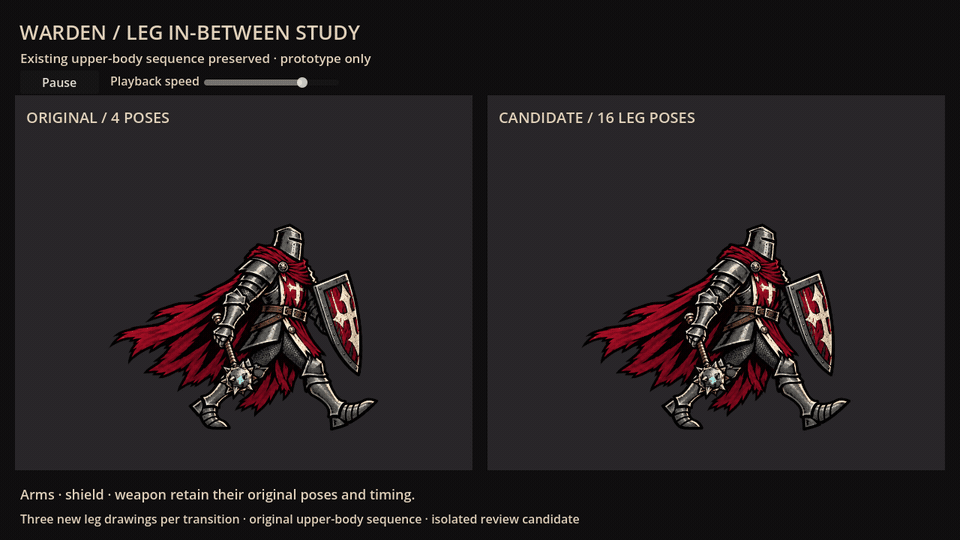

# Warden leg in-between preview

This isolated study responds to the request for smoother legs while preserving the original walking arms and other approved movement. The live game and its walking settings are unchanged; the older paused animation lab and Spine handoff are also unchanged.



[30 fps comparison video](preview/comparison.mp4) · [16 transparent walking frames](preview/warden-walking-frames.zip) · [Frame folder](preview/frames)

## What changes

The left view cycles the four original Warden walking drawings. The right view inserts **three new lower-body poses per transition**, yielding sixteen poses over the same cycle. The original key poses remain at indices **0, 4, 8 and 12**. The upper body continues to use its original four-frame sequence; the protected mace and hand regions are also retained from the source.

Twelve new intermediate drawings were generated from the four original Warden reference poses. Their full-body artwork is preserved in `godot/assets/warden_leg_inbetweens.png`, but the renderer selects only masked lower-body regions. It retains original red cloth where visible and uses the generated drawing to fill newly exposed leg/cloth overlaps. This is **not** the earlier articulated Warden reconstruction, and it does not warp the whole character or simply crossfade two silhouettes.

These are AI-drawn review frames, not final hand-authored production animation. Plate contours, cloth borders around the legs, and a few retained pixels around the weapon can still need artist cleanup. The method cannot reconstruct every hidden layer from flattened sprites. No exact Darkest Dungeon match is claimed. Only the original Warden outfit is covered; alternate/relic outfits, palette changes and equipment accent overlays are not part of this experiment.

## Run and inspect

Import `godot/project.godot` separately in Godot 4.6+, then press F5. Pause freezes both views, and Playback speed changes both views together. Default timing is six original poses per second and twenty-four candidate poses per second, so the overall cycle duration is unchanged.

```sh
godot --path experiments/warden_walk_frames/godot --editor --import --quit
godot --path experiments/warden_walk_frames/godot
```

The parent `.gdignore` isolates project imports and exports from the game. This lab has no game autoloads, saves, campaign state or runtime dependencies.

## Individual frames and replacements

`preview/frames/frame_00.png` through `frame_15.png` are the composited transparent candidate frames. All use a **590 × 470** canvas with the ground/root point at **(305,420)** and a 280-pixel logical hero height. Keep that canvas and root registration when replacing individual images by hand. `original_0.png` through `original_3.png` are the four baseline images for verification, not additional candidate poses. `frame-index.json` records timing and the original keyframe indices.

These padded review canvases are not drop-in replacements for the live game's textures: its current sizing uses the full texture height. A future port must crop all frames to common registered bounds or explicitly respect the recorded hero height and root, so the character does not shrink.

Source pixels are unchanged in the copied original sheet. `poses.json` records lower-body/protected-equipment masks; `tweens.json` records measured source rectangles and registration for the generated intermediates. The generated sheet has **irregular row gaps**, so the regions use measured row bounds rather than assuming equal cells. `sources.json` records hashes for both source images. The generated original output remains unmodified.

## Verification and capture

```sh
godot --headless --path experiments/warden_walk_frames/godot --script res://smoke.gd
godot --path experiments/warden_walk_frames/godot --script res://capture.gd -- /absolute/sprite-output sprites
python experiments/warden_walk_frames/verify_frames.py /absolute/sprite-output
godot --path experiments/warden_walk_frames/godot --script res://capture.gd -- /absolute/comparison-output movie
```

The pixel guard uses Pillow and NumPy for read-only verification. It checks all sixteen exported frames: exact protected upper pixels, exact protected hand/weapon pixels, unchanged original key poses, and the generated-source hash. Native capture checks shader compilation and the actual composite. The smoke script verifies routing, image bounds, masks, loop, pause, and playback. These checks establish preservation and data correctness; visual acceptance of the leg movement is still required before any live-game port.

The comparison clip is 80 native 1280 × 720 frames at 30 fps, covering four full cycles. The GIF is a 960-pixel-wide preview sampled at 24 fps.
